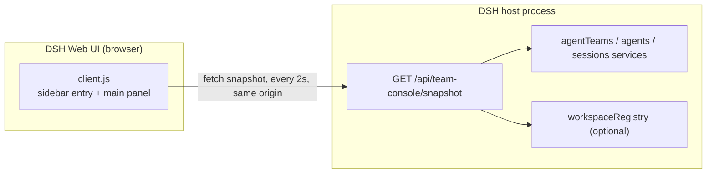

# Agent Team Console

Read-only Agent Teams dashboard for the DeepSeek Harness Web UI (`dsh-agent-team-console`): a
project-scoped, in-progress-first view of the live roster, shared tasks, and collaboration activity in
one first-class main panel.

English | [中文](README.zh.md)

Repository: <https://github.com/kkomia/dsh-agent-team-console>

> **Unofficial community plugin.** This repository is not part of the DeepSeek official packages, is
> not published or endorsed by DeepSeek, and is not a replacement for the official experimental
> Agent Teams bundle. It is a read-only viewer: it never creates, changes, or completes a team
> member or a task.

## Why this plugin

The official experimental Agent Teams Web UI (`@deepseek-ai/dsh-experimental-client-ui-agent-team`)
adds a compact roster and task-board action to the conversation header. That is convenient for a
quick check while you are inside the Lead conversation, but it is not a page of its own.

Agent Team Console keeps the same read-only contract and adds a sidebar entry plus a full main
panel for people who keep a team running for a long stretch:

- A project filter and an in-progress-first status strip that keep current work visible at a glance.
- A compact active-first roster with live status, model information, and last activity.
- Shared tasks grouped in-progress first, then compact pending rows and a collapsed completed group,
  with owners, readiness markers for pending tasks, and advisory write scopes.
- A compact activity list derived from the Lead session activity log.

It is a plain DeepSeek Harness (DSH) Web plugin: no build step for users, no npm dependencies, and no
external services.

## Features

- **Sidebar entry and main panel.** A sidebar item labelled "Team console" (the Chinese UI shows
  "团队看板") opens a dedicated page in the main area.
- **Project filter.** When more than one project (workspace) has live teams, a select appears in the
  header. It defaults to "All projects" and narrows the status strip and the team list to one project;
  the choice is client-side and is not persisted.
- **In-progress-first status strip.** A single compact row of four chips: in-progress tasks, running
  members (running / total), blocked tasks (pending tasks that are not ready), and pending tasks. Zero
  values stay visible but muted.
- **Active-first team sections.** Teams are ordered active first, then by most recent activity. Active
  teams (a running or provisioning member, or an in-progress task) expand by default; idle teams are
  collapsed behind a header that still shows the project, Lead, counters, and last activity.
- **Roster chips.** One compact wrapping row per team, active members first (running or provisioning,
  then idle, then failed). Each chip shows the avatar initial, name, role, and status; the model and
  last activity are in its tooltip. Up to 8 members are shown, with a "N more" chip for the rest.
- **In-progress-first tasks.** In-progress task cards come first and carry the strongest visual
  weight: subject, owner, advisory write scopes, and an expandable description. In-progress tasks are
  claimed work and never show a blocked warning. Pending tasks are compact one-line rows: a ready task
  (all blockers completed) shows a ready marker, while a task whose blockers are still open shows a
  blocked marker with the blocker ids when known. Completed tasks sit behind a collapsed "Completed N"
  toggle per team.
- **Compact activity.** The latest 8 team and task events for a team, newest first, with relative time
  and localized action labels.
- **Multiple teams and projects.** One collapsible section per live team, filtered by project when a
  project is selected.
- **Honest states.** A loading skeleton on first load, an error card with retry, a "showing the last
  successful snapshot" hint after a failed poll, an unsupported-service notice, and an empty state.
- **Bilingual.** All visible copy goes through the DSH client locale service, with Chinese and
  English dictionaries kept in sync; the panel follows the host language.
- **Theme-native.** Colors, borders, and backgrounds come only from `--dsw-*` theme tokens, so the
  panel follows dark and light themes. Reduced motion is respected, and member chips are keyboard
  accessible.
- **Polling.** The panel refreshes a same-origin JSON snapshot every 2 seconds while it is mounted and
  the tab is visible, pauses while the tab is hidden, and offers a manual refresh button.
- **Optional navigation.** When the host exposes `uiWorkspace.openSession`, clicking a member chip
  opens that member's session. When it does not, the panel stays a read-only page.

## Requirements and compatibility

- **DSH Web UI** in the desktop app or a Web profile. The plugin was developed and tested against DSH
  `0.2.1-rc.2`; `package.json` declares `engines.dsh` as `>=0.2.1-rc.2 <0.3.0-0`, which also excludes
  0.3.0 prereleases.
- **The official experimental Agent Teams bundle must be mounted in the same profile.** This plugin
  visualizes teams that already exist; it does not provide the Agent Teams service itself. Without
  that service the panel shows a clear "not mounted" notice instead of failing.
- **A Web-capable profile.** The install examples below use the `desktop` profile; replace `desktop`
  with your own Web profile name (`web`, and so on) if it differs.
- **No separate Node.js installation is needed to use the plugin.** Node.js 22.19 or newer is only
  needed to run the tests in this repository.

## Install

The examples below use `dsh plugin --profile desktop add <spec>`. Replace `desktop` with your profile
name if you use a different Web profile.

### From the app Plugins page

1. Open **Plugins** in the DSH desktop app.
2. Choose **Add plugin**.
3. Paste `github:kkomia/dsh-agent-team-console` (or `dsh-agent-team-console` once the package is
   published on npm), then confirm the install.
4. Restart the app so the host half loads, then open the Web UI.

### From the command line

GitHub repository (works today):

```sh
dsh plugin --profile desktop add github:kkomia/dsh-agent-team-console
```

npm registry (once the package is published on npm):

```sh
dsh plugin --profile desktop add dsh-agent-team-console
```

GitHub installs are resolved through the network and need Git (and pnpm, which DSH's plugin manager
already uses). The repository has no build step, so the install is a plain copy of the package files.

### Activation

The host half registers an HTTP route when the DSH host process starts, so **restart the desktop app
after installing or upgrading**; then refresh the Web UI page if it is already open. If only client
assets changed and the host is unchanged, a page refresh is enough.

## Usage

### Open the panel

Select **Team console** in the sidebar. The panel loads the current snapshot immediately and then
keeps polling every 2 seconds while it is visible.

### Read the header

The header shows the page title and subtitle, the project filter when it applies, a live indicator
(pulsing while any member is running), the time of the last successful update, and a refresh button
that spins while a manual refresh is in flight.

### Filter by project

When the snapshot lists more than one project (workspace), a project select appears in the header. It
starts at "All projects"; choosing a project narrows the status strip and the team sections to that
project's teams. The filter is client-side only: it is not saved, and remounting the panel resets it
to "All projects". Projects with duplicate titles get a short path tail in their option label so they
stay distinguishable. Teams whose project cannot be resolved appear under "All projects" only.

### Read the status strip

The status strip is a compact row of four chips for the current selection: in-progress tasks, running
members (running / total), blocked tasks, and pending tasks. The blocked chip counts pending tasks
that are not ready; in-progress and completed tasks are never counted as blocked. A chip with a value
of zero stays visible but is muted. Completed tasks are not counted in the strip; they appear per team
behind the completed toggle.

### Read the team sections

Teams are listed active first, then by most recent activity. Each team header shows a status dot, the
project chip when known, the Lead name and role, in-progress, member, and blocked counters (blocked
counts pending tasks that are not ready and is shown only when non-zero), and the last activity time.
Active teams are expanded by default; idle teams start collapsed and can be expanded with the header
toggle. Expansion state is kept while the panel stays mounted.

### Read the roster

The roster is a compact row of member chips, active members first: running and provisioning, then
idle, then failed. Each chip shows the avatar initial, name, role tag, and a status dot with its label;
hovering it reveals the model and last activity time. Up to 8 members are shown per team, with an
"N more" chip when the roster is longer.

### Read the task sections

Tasks are grouped in-progress first. In-progress task cards show the subject, owner, advisory write
scopes, and a description that can be expanded; they carry no blocked warning, because a task in
progress is claimed work. Pending tasks are compact one-line rows with the owner and a readiness
marker: a pending task is ready when all of its blockers are completed, and only a pending task that
is not ready shows a blocked marker with the blocker ids when known. Readiness is derived by the host:
`ready` is true only for pending tasks whose blockers are all completed, and the retained `blockedBy`
list does not by itself mean a task is blocked. Completed tasks are collapsed behind a "Completed N"
toggle per team; expanding it shows dimmed one-line rows.

### Read the activity

The activity list shows up to 8 of the latest team and task events for a team, newest first, with
relative timestamps. Task actions are shown with localized action labels, so a claimed task reads like
"task-3 · claimed · reviewer" in English or "task-3 · 认领 · reviewer" in Chinese; the raw server-side
action label only appears in fallback text. Event shapes the plugin does not recognize are shown
through a readable fallback label instead of being dropped or throwing.

### Open a member session

Click a member chip (or focus it and press Enter or Space) to open that member's session when the
host provides workspace navigation. This is an optional convenience: when the service is not
available, chips are not clickable.

### Refresh manually

The refresh button in the header requests one snapshot immediately. The regular 2-second polling
continues as usual.

### Understand the other states

- **Unsupported.** The snapshot route answered, but the Agent Teams service is not mounted in this
  profile. A notice explains this and the page remains empty.
- **Error.** The first load failed. An error card shows the message and a retry button.
- **Stale.** A later poll failed after a successful load. The last data stays visible with a warning
  hint until a poll succeeds again.
- **Empty.** No live team was found. The empty state explains that teams appear here automatically
  once teammates or shared tasks exist, and that idle teams stay listed when they exist.

## Read-only and privacy

Agent Team Console is deliberately conservative:

- **One read-only route.** The host half serves exactly `GET /api/team-console/snapshot`; for admitted
  requests, any other path returns a JSON 404. No POST, PUT, PATCH, or DELETE route exists, and the
  handler never reads the request body.
- **No mutations.** Neither half calls a create, update, delete, claim, complete, spawn, or interrupt
  operation on a team, member, task, or session service.
- **No external network access.** The panel fetches a relative, same-origin URL. There is no CDN, no
  remote font or image, no telemetry, and no analytics call.
- **No disk access and no timers on the host.** The host half keeps no mutable module state and
  touches no files; every request rebuilds a snapshot from live read-only service reads.
- **Minimal client dependencies.** The browser bundle requires only `react` from the host module
  system; it imports no `@deepseek-ai/*` package and no third-party bundle.
- **Data stays local.** The snapshot is assembled from data the Web UI already holds (names, roles,
  statuses, task text) and is served by the local Harness Web server, typically on a loopback
  address, only to same-origin clients of your own instance.
- **Admission matches the Web UI.** When the host mounts the DSH `connection` service, the route asks
  it to admit every request before running any route logic: a request that fails the Host/Origin fence
  or the browser-session check receives a JSON `401` (`unauthorized`) or `403` (`forbidden`) response
  and is rejected exactly like any other Web UI request. An authenticated same-origin browser fetch is
  admitted. If a host does not mount that service, the route leaves admission to the deployment's own
  access control.
- **Bounded payloads.** Text fields are capped (task descriptions at 2000 characters, activity labels
  at 200 characters); the snapshot is JSON-safe by construction.

## How it works



### Host half (`index.js`)

`index.js` has zero `import` statements so a plain Node test can load it. It exports
`inject = ['webServer']` and `apply(ctx)`, which registers a prefix route under
`/api/team-console` inside `ctx.effect(...)`, so unloading the plugin disposes the route.

On every request the handler first applies the optional DSH `connection` service's admission check;
a request that fails the Host/Origin fence or browser-session admission gets a JSON 401/403 before any
route logic. It then resolves the optional `agentTeams`, `agents`, `sessions`, and
`workspaceRegistry` services through `ctx.get(...)`. If Agent Teams is missing it returns a valid
snapshot with an `unsupported` reason. Otherwise it enumerates live agents, keeps the ones with a Lead
role, reads the roster and task board for each team, enriches members from their session activity,
normalizes team and task events into activity entries, resolves each team's project (workspace
registry first, then the Lead session working directory, otherwise null), and computes the per-team
counts and `active` flags. It then aggregates the top-level `totals` and `projects` and returns one
JSON-safe snapshot with contract version 2. Teams are ordered active first, then by most recent
activity. Unexpected aggregation failures become a valid JSON 500 body; unknown routes become a JSON
404 body.

### Client half (`client.js`)

`client.js` is a self-registering browser bundle loaded through `window.__ModuleLoader__.load`, with
an id equal to the package name. Its factory requires only `react`. `apply(ctx)` registers the
Chinese and English locale dictionaries under the `agent-team-console` namespace inside
`ctx.effect(...)`, then registers a `sidebar.panellist` entry (id `team-console`, order 20) and a
`main` panel (key `team-console`).

The panel keeps the project selection and the per-team expand/collapse state in local React state (no
storage), renders the project filter and the compact status strip, and lays out one collapsible
section per team. It renders one `<style>` element that uses only `--dsw-*` tokens, so styles
disappear together with the panel. It polls the same-origin snapshot every 2 seconds while mounted and
the tab is visible, keeps an in-flight guard, aborts the active request on unmount, and never attaches
global listeners outside React effects. The host rebuilds the snapshot per request, so the view stays
near live without a push channel, while the read-only guarantee stays easy to audit: no mutation call
exists in either half.

## Development

Requirements: Node.js 22.19 or newer for the test tooling. There are no npm dependencies and no build
step; `client.js` is a hand-written, committed browser bundle.

```sh
node --check index.js
node --check client.js
node --test test/snapshot.test.mjs
node scripts/ci-guard.mjs
```

`npm run check` runs the syntax checks and the test suite, and `npm test` runs the tests alone. The
tests use only Node built-ins and fake Cordis services; they cover the snapshot contract (version 2,
project resolution, active ordering), unknown event shapes, JSON safety, and the 200/404/500 route
behavior. `scripts/ci-guard.mjs` runs 32 checks over the cross-file DSH wiring (manifest, patch,
exports, client registration, locale metadata, and the embedded client dictionary key parity), which
is the part that can break without any unit test failing.

To try a local change in a live app, install the package into a DSH profile (an absolute local path
is accepted as an install spec), restart the app, and open the panel. Host log lines are prefixed
`[agent-team-console]`.

To check a running instance's snapshot route from the command line, run
`TEAM_CONSOLE_URL=http://127.0.0.1:10100 node scripts/verify-live.mjs`. It exits `0` when the route
is reachable and the v2 contract matches, `1` when the route is unreachable or the contract is
violated, and `2` when admission rejects the request as unauthenticated. A `2` is expected against a
running DSH desktop app: the route enforces DSH connection admission, so an anonymous command-line
probe is answered with a JSON 401 before any snapshot logic, while the authenticated browser UI
works. The script is useful only where you can pass admission, such as an authenticated setup you
control.

## Project structure

| Path | What it is |
| --- | --- |
| [`index.js`](index.js) | Host half: route registration and snapshot aggregation (no imports) |
| [`client.js`](client.js) | Client half: self-registering browser bundle (slots, locale, panel, polling) |
| [`cordis.patch.yml`](cordis.patch.yml) | Bundle patch that inserts the plugin into the profile's loader |
| [`package.json`](package.json) | Package manifest: DSH bundle/client metadata, exports, scripts |
| [`locale/en.json`](locale/en.json), [`locale/zh.json`](locale/zh.json) | Display metadata (title and description) for the Plugins page |
| [`icon.svg`](icon.svg) | Plugin icon |
| [`test/snapshot.test.mjs`](test/snapshot.test.mjs) | Host snapshot contract and unit tests (`node:test`, no dependencies) |
| [`scripts/ci-guard.mjs`](scripts/ci-guard.mjs) | Cross-file DSH manifest and wiring guard used by CI |
| [`scripts/verify-live.mjs`](scripts/verify-live.mjs) | Dependency-free probe that validates a running instance's snapshot route |
| [`.github/workflows/ci.yml`](.github/workflows/ci.yml) | CI: syntax checks, manifest guard, and tests on Node 22 and 24 |
| [`.gitignore`](.gitignore) | Ignored local files (dependencies, logs, coverage, environment files, editor state) |
| [`docs/design.md`](docs/design.md) | Public architecture, HTTP contract, and design notes |
| [`CONTRIBUTING.md`](CONTRIBUTING.md) | Development setup, conventions, and pull request flow |
| [`CHANGELOG.md`](CHANGELOG.md) | Release notes |
| [`LICENSE`](LICENSE) | MIT license |

## Limitations

- **Unofficial and experimental.** This is a community plugin built on the experimental Agent Teams
  services, which may change between DSH versions. The declared compatibility range is
  `>=0.2.1-rc.2 <0.3.0-0`.
- **Polling, not push.** Data can be up to about 2 seconds old, and the host rebuilds the snapshot for
  every request. Polling pauses while the tab is hidden.
- **Only real teams are listed.** A team appears when it has more than one member or at least one
  shared task; an ordinary single-agent Lead session is not listed.
- **The project filter is client-side.** It is not persisted and is hidden when only one project has
  live teams. Teams whose project cannot be resolved appear under "All projects" only.
- **Activity is derived.** The activity list comes from bounded reads of the Lead session's team and
  task events: at most 40 entries are assembled on the host and the newest 8 are shown. Unknown event
  shapes fall back to a generic label.
- **No mailbox timeline.** Peer messages are not shown; the official roster and task board are the
  source of truth.
- **Navigation is optional.** Opening a member session depends on the optional `uiWorkspace` service;
  without it the panel remains a pure viewer.
- **No controls, by design.** There is no spawn, rename, interrupt, claim, complete, or delete action,
  and write scopes are shown as advisory metadata only.
- **Web UI only.** The plugin affects the DSH Web client; CLI and headless surfaces are unchanged.

## License

[MIT](LICENSE) © 2026 kkomia.

DeepSeek Harness and related names are trademarks of their respective owners. This project is not
affiliated with or endorsed by DeepSeek.
