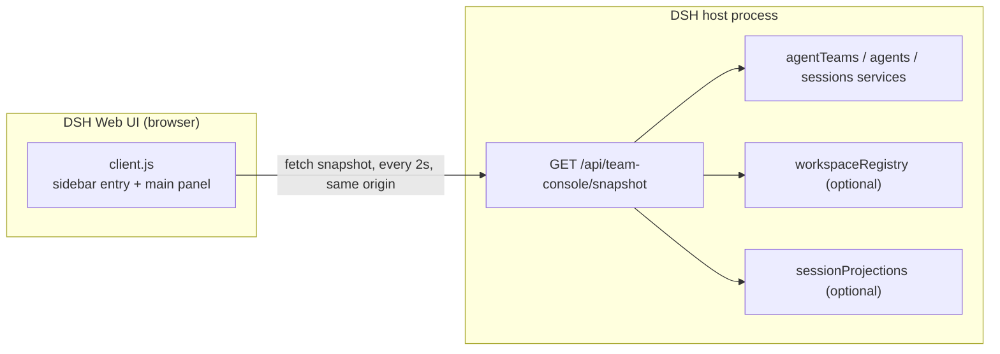

# Agent Team Console

Read-only Agent Teams dashboard for the DeepSeek Harness Web UI (`dsh-agent-team-console`): a
project-scoped, graph-first live view for every team, with workspace-first headers, a pixel-art agent
interaction graph, and rounds / token / working-time statistics in one first-class main panel.

English | [中文](README.zh.md)

Repository: <https://github.com/kkomia/dsh-agent-team-console>

> **Unofficial community plugin.** This repository is not part of the DeepSeek official packages, is
> not published or endorsed by DeepSeek, and is not a replacement for the official experimental
> Agent Teams bundle. It is a read-only viewer: it never creates, changes, or completes a team
> member or a task.

## Why this plugin

The official experimental Agent Teams Web UI (`@deepseek-ai/dsh-experimental-client-ui-agent-team`)
adds a compact roster and task-board action to the conversation header. That is convenient for a
quick check while you are inside the Lead conversation, but it is not a page of its own.

Agent Team Console keeps the same read-only contract and adds a sidebar entry plus a full main
panel for people who keep a team running for a long stretch:

- A project filter and a compact status strip covering in-progress tasks, running members, token
  usage, blocked tasks, and pending tasks.
- Workspace-first team headers with a working-vs-idle donut plus team rounds and token totals.
- A pixel-art agent interaction graph: Lead at the center, teammates on a ring, lead links and
  message-traffic chords between them.
- A one-line task summary with in-progress rows on demand, so the page stays visual instead of a wall
  of text.

It is a plain DeepSeek Harness (DSH) Web plugin: no build step for users, no npm dependencies, and no
external services.

## Features

- **Sidebar entry and main panel.** A sidebar item labelled "Team console" (the Chinese UI shows
  "团队看板") opens a dedicated page in the main area.
- **Project filter.** When more than one project (workspace) has live teams, a select appears in the
  header. It defaults to "All projects" and narrows the status strip and the team list to one project;
  the choice is client-side and is not persisted.
- **In-progress-first status strip.** A single compact row of five chips: in-progress tasks, running
  members (running / total), token usage for the current selection, blocked tasks (pending tasks that
  are not ready), and pending tasks. Zero values stay visible but muted.
- **Workspace-first team sections.** Teams are ordered active first, then by most recent activity.
  Each team header starts with the prominent workspace/project name (falling back to "No project",
  "未分组" in the Chinese UI), then the Lead name and role, a status dot, a working-vs-idle donut with
  a "work · idle" caption, team rounds, team token totals, an in-progress count when non-zero, and the
  expand/collapse toggle. Active teams expand by default; idle teams stay collapsed.
- **Animated interaction graph.** The linear stage is replaced by an SVG graph: the Lead sits in the
  center hub and teammates sit on an evenly spaced ring (up to 8, then a "+N" overflow node). Faint
  curved lead spokes connect the Lead to every teammate, and curved message chords connect members
  with observed peer messages — live `agent-message` deliveries seen in the member session logs, plus
  legacy `team/message/queued` records when present — within bounded per-member scans; chord thickness
  scales with message count, opacity with recency, and a small flow animation shows the direction of
  recent traffic. A structural star is derived when a payload has no edge data.
- **Pixel-art agents.** Every member is drawn as a deterministic pixel-art character made of SVG
  rectangles from a 10x12 template (no external images): the Lead gets a distinct brand-colored outfit
  and marker, and the theme palette drives outfit accents. The working-ratio ring and token-scaled node
  radius are still there, with a tiny "N rounds · X tok" line under each node. Status motion: running
  bobs and shows a working spark, provisioning spins a dashed ring and blinks softly, idle is muted and
  static, failed keeps a static error ring.
- **Member details on hover or focus.** Hovering or focusing a node opens a compact detail card with
  the model, rounds, steps, token breakdown (uncached input, cache read, cache write, output, total),
  working and idle time, and the member's message in/out summary. Clicking the node opens the member's
  session when workspace navigation is available.
- **Compact task summary.** Each team shows one line with in-progress, pending, and blocked counts and
  a small expand toggle. Expanding shows only the in-progress tasks as one-line rows (subject, owner);
  pending and completed tasks stay counts only. Blocked follows the readiness rule: only a pending
  task with `ready === false` is blocked, and in-progress tasks are never shown as blocked.
- **Activity stays in the API.** The snapshot still carries the bounded activity list for API
  consumers, but the panel no longer renders it.
- **Interactive graph data.** When the host can see it, the snapshot also carries the member graph:
  structural Lead edges plus aggregated message edges from bounded member-session (live deliveries) and
  Lead-session (legacy records) scans. The panel remains read-only either way.
- **Multiple teams and projects.** One collapsible section per live team, filtered by project when a
  project is selected.
- **Honest states.** A loading skeleton on first load, an error card with retry, a "showing the last
  successful snapshot" hint after a failed poll, an unsupported-service notice, and an empty state.
- **Bilingual.** All visible copy goes through the DSH client locale service, with Chinese and
  English dictionaries kept in sync; the panel follows the host language.
- **Theme-native.** Colors, borders, and pixel-art/graph art come only from `--dsw-*` theme tokens, so
  the panel follows dark and light themes. Graph nodes are keyboard accessible and every animation is
  disabled under reduced motion.
- **Polling.** The panel refreshes a same-origin JSON snapshot every 2 seconds while it is mounted and
  the tab is visible, pauses while the tab is hidden, and offers a manual refresh button.
- **Optional navigation.** When the host exposes `uiWorkspace.openSession`, clicking a graph node
  opens that member's session. When it does not, the panel stays a read-only page.

## Requirements and compatibility

- **DSH Web UI** in the desktop app or a Web profile. The plugin was developed and tested against DSH
  `0.2.1-rc.2`; `package.json` declares `engines.dsh` as `>=0.2.1-rc.2 <0.3.0-0`, which also excludes
  0.3.0 prereleases.
- **The official experimental Agent Teams bundle must be mounted in the same profile.** This plugin
  visualizes teams that already exist; it does not provide the Agent Teams service itself. Without
  that service the panel shows a clear "not mounted" notice instead of failing.
- **Optional session projections.** Rounds, token usage, and working / idle times come from the stock
  DSH `sessionStats` and `tokenUsage` projections. They are optional: without them the panel still
  renders the graph and shows dashes for statistics.
- **A Web-capable profile.** The install examples below use the `desktop` profile; replace `desktop`
  with your own Web profile name (`web`, and so on) if it differs.
- **No separate Node.js installation is needed to use the plugin.** Node.js 22.19 or newer is only
  needed to run the tests in this repository.

## Install

The examples below use `dsh plugin --profile desktop add <spec>`. Replace `desktop` with your profile
name if you use a different Web profile.

### From the app Plugins page

1. Open **Plugins** in the DSH desktop app.
2. Choose **Add plugin**.
3. Paste `github:kkomia/dsh-agent-team-console` (or `dsh-agent-team-console` once the package is
   published on npm), then confirm the install.
4. Restart the app so the host half loads, then open the Web UI.

### From the command line

GitHub repository (works today):

```sh
dsh plugin --profile desktop add github:kkomia/dsh-agent-team-console
```

npm registry (once the package is published on npm):

```sh
dsh plugin --profile desktop add dsh-agent-team-console
```

GitHub installs are resolved through the network and need Git (and pnpm, which DSH's plugin manager
already uses). The repository has no build step, so the install is a plain copy of the package files.

### Activation

The host half registers an HTTP route when the DSH host process starts, so **restart the desktop app
after installing or upgrading**; then refresh the Web UI page if it is already open. If only client
assets changed and the host is unchanged, a page refresh is enough.

## Usage

### Open the panel

Select **Team console** in the sidebar. The panel loads the current snapshot immediately and then
keeps polling every 2 seconds while it is visible.

### Read the header

The header shows the page title and subtitle (a one-line description of the live graph), the project
filter when it applies, a live indicator (pulsing while any member is running), the time of the last
successful update, and a refresh button that spins while a manual refresh is in flight.

### Filter by project

When the snapshot lists more than one project (workspace), a project select appears in the header. It
starts at "All projects"; choosing a project narrows the status strip, its token total, and the team
sections to that project's teams; each team header shows its workspace name. The filter is
client-side only: it is not saved, and remounting the panel resets it to "All projects". Projects with
duplicate titles get a short path tail in their option label so they stay distinguishable. Teams
whose project cannot be resolved appear under "All projects" only.

### Read the status strip

The status strip is a compact row of five chips for the current selection: in-progress tasks, running
members (running / total), token usage summed across the filtered teams (shown compactly, such as
`1.2M tok`), blocked tasks, and pending tasks. The blocked chip counts pending tasks that are not
ready; in-progress and completed tasks are never counted as blocked. A chip with a value of zero stays
visible but is muted. Completed tasks are not counted in the strip; they appear only in the per-team
task summary.

### Read the team sections

Teams are listed active first, then by most recent activity. Each team header starts with the
prominent workspace/project name, followed by the Lead name and role, a status dot, a working-vs-idle
donut with a "work · idle" caption, team rounds, team token totals, and an in-progress count when
non-zero. Clicking the header expands or collapses the team; active teams start expanded and idle
teams start collapsed. Expansion state is kept while the panel stays mounted.

### Read the interaction graph

Each team body is an SVG interaction graph. The Lead sits in the center hub and the other members are
placed on an evenly spaced ring around it; up to 8 members are drawn, and a "+N" node stands in for any
overflow. A small legend above the graph labels the two edge kinds when they are present:

- **Lead links** (faint curved spokes) connect the Lead to every teammate.
- **Message links** (curved chords, brand color) connect pairs of members with observed peer messages:
  live `agent-message` deliveries in each member's session log, plus legacy `team/message/queued`
  records when present, observed within bounded per-member scans. Thicker chords mean more messages in
  the observed window, brighter chords are more recent, and recent chords carry a small flow animation
  showing the direction of the traffic.

Members are drawn as deterministic pixel-art characters made of SVG rectangles (no external images):
the Lead gets a brand-colored outfit and marker, and each teammate's hair, outfit accent, and
accessory vary deterministically from their identity. Node radius grows with token usage (log-scaled
against the team's busiest member), an outer arc shows the working ratio, and a tiny
"N rounds · X tok" line sits under each node. Status motion: running bobs with a working spark,
provisioning spins a dashed ring and blinks softly, idle is muted and static, and failed keeps a static
error ring. If the payload has no edge data, the graph still renders as a structural star from the
center member. Animations respect the host's reduced-motion preference.

### Read the node details

Hovering or focusing a node opens a detail card below the graph: model, rounds, steps, the token
breakdown (uncached input, cache read, cache write, output, total), working and idle time, and the
member's message summary (received and sent counts). The card closes when the pointer or focus leaves
the node.

### Read the task summary

Each team body ends with a single summary line: in-progress, pending, and blocked counts plus a small
expand toggle. Expanding it shows only the in-progress tasks as compact one-line rows with the subject
and owner; pending and completed tasks stay as counts. Readiness is derived by the host: a pending task
is ready when all of its blockers are completed, and only a pending task that is not ready is counted
and shown as blocked. In-progress tasks are claimed work and never show a blocked warning.

### Open a member session

Click a graph node (or focus it and press Enter or Space) to open that member's session when the host
provides workspace navigation. This is an optional convenience: when the service is not available,
nodes are not clickable.

### Refresh manually

The refresh button in the header requests one snapshot immediately. The regular 2-second polling
continues as usual.

### Understand the other states

- **Unsupported.** The snapshot route answered, but the Agent Teams service is not mounted in this
  profile. A notice explains this and the page remains empty.
- **Error.** The first load failed. An error card shows the message and a retry button.
- **Stale.** A later poll failed after a successful load. The last data stays visible with a warning
  hint until a poll succeeds again.
- **Empty.** No live team was found. The empty state explains that teams appear here automatically
  once teammates or shared tasks exist, and that idle teams stay listed collapsed when they exist.

## Read-only and privacy

Agent Team Console is deliberately conservative:

- **One read-only route.** The host half serves exactly `GET /api/team-console/snapshot`; for admitted
  requests, any other path returns a JSON 404. No POST, PUT, PATCH, or DELETE route exists, and the
  handler never reads the request body.
- **No mutations.** Neither half calls a create, update, delete, claim, complete, spawn, or interrupt
  operation on a team, member, task, or session service.
- **No external network access.** The panel fetches a relative, same-origin URL. There is no CDN, no
  remote font or image, no telemetry, and no analytics call.
- **No disk access and no timers on the host.** The host half keeps no mutable module state and
  touches no files; every request rebuilds a snapshot from live read-only service reads.
- **Minimal client dependencies.** The browser bundle requires only `react` from the host module
  system; it imports no `@deepseek-ai/*` package and no third-party bundle.
- **Data stays local.** The snapshot is assembled from data the Web UI already holds (names, roles,
  statuses, task text) and is served by the local Harness Web server, typically on a loopback
  address, only to same-origin clients of your own instance.
- **Admission matches the Web UI.** When the host mounts the DSH `connection` service, the route asks
  it to admit every request before running any route logic: a request that fails the Host/Origin fence
  or the browser-session check receives a JSON `401` (`unauthorized`) or `403` (`forbidden`) response
  and is rejected exactly like any other Web UI request. An authenticated same-origin browser fetch is
  admitted. If a host does not mount that service, the route leaves admission to the deployment's own
  access control.
- **Bounded payloads.** Text fields are capped (task descriptions at 2000 characters, activity labels
  at 200 characters); the snapshot is JSON-safe by construction.

## How it works



### Host half (`index.js`)

`index.js` has zero `import` statements so a plain Node test can load it. It exports
`inject = ['webServer']` and `apply(ctx)`, which registers a prefix route under
`/api/team-console` inside `ctx.effect(...)`, so unloading the plugin disposes the route.

On every request the handler first applies the optional DSH `connection` service's admission check;
a request that fails the Host/Origin fence or browser-session admission gets a JSON 401/403 before any
route logic. It then resolves the optional `agentTeams`, `agents`, `sessions`, `workspaceRegistry`, and
`sessionProjections` services through `ctx.get(...)`. If Agent Teams is missing it returns a valid
snapshot with an `unsupported` reason. Otherwise it enumerates live agents, keeps the ones with a Lead
role, reads the roster and task board for each team, enriches members from a bounded session tail,
resolves each team's project, and reads each member's session statistics from the optional session
projections (`sessionStats` and `tokenUsage`): two bounded projection reads per member, never a
session-log scan for stats. It computes turns, steps, token buckets, working / idle / wall time, and a
working ratio, aggregates them per team, and builds each team's interaction graph: structural Lead
edges plus `message` edges aggregated from two bounded sources — live `agent-message` deliveries in
each member's session log (the newest 1000 events per listed member, Lead included) and legacy
`team/message/queued` records in the newest 2000 Lead-session events; weights add, message counts are
capped at 99, and the newest timestamp is kept. It returns one JSON-safe snapshot with contract
version 4. Teams are ordered active first, then by most recent activity. Unexpected aggregation
failures become a valid JSON 500 body; unknown routes become a JSON 404 body.

### Client half (`client.js`)

`client.js` is a self-registering browser bundle loaded through `window.__ModuleLoader__.load`, with
an id equal to the package name. Its factory requires only `react`. `apply(ctx)` registers the
Chinese and English locale dictionaries under the `agent-team-console` namespace inside
`ctx.effect(...)`, then registers a `sidebar.panellist` entry (id `team-console`, order 20) and a
`main` panel (key `team-console`).

The panel keeps the project selection, the per-team expand state, and the per-team task-summary state
in local React state (no storage), renders the project filter, the five-chip status strip, and one
collapsible section per team whose header starts with the workspace name. The body is an animated SVG
interaction graph with deterministic pixel-art characters plus a compact task summary; the wire
contract still carries the activity list but the panel does not render it. All styles, graph art, and
animations come from one `<style>` element that uses only `--dsw-*` tokens, animations are disabled
under reduced motion, and polling keeps the same 2-second, visibility-aware, cleanup-safe behavior as
before.

## Development

Requirements: Node.js 22.19 or newer for the test tooling. There are no npm dependencies and no build
step; `client.js` is a hand-written, committed browser bundle.

```sh
node --check index.js
node --check client.js
node --test test/snapshot.test.mjs
node scripts/ci-guard.mjs
```

`npm run check` runs the syntax checks and the test suite, and `npm test` runs the tests alone. The
suite currently has 50 tests that use only Node built-ins and fake Cordis services; they cover the
snapshot contract (version 4, project resolution, active ordering, session stats and their optional
degradation, and the interaction-graph edges from both live and legacy sources), unknown event shapes,
JSON safety, and the 200/404/500 route behavior. `scripts/ci-guard.mjs` runs 32 checks over the
cross-file DSH wiring (manifest, patch, exports, client registration, locale metadata, and the embedded
client dictionary key parity), which is the part that can break without any unit test failing.

To try a local change in a live app, install the package into a DSH profile (an absolute local path
is accepted as an install spec), restart the app, and open the panel. Host log lines are prefixed
`[agent-team-console]`.

To check a running instance's snapshot route from the command line, run
`TEAM_CONSOLE_URL=http://127.0.0.1:10100 node scripts/verify-live.mjs`. It exits `0` when the route
is reachable and the v4 contract matches, `1` when the route is unreachable or the contract is
violated, and `2` when admission rejects the request as unauthenticated. A `2` is expected against a
running DSH desktop app: the route enforces DSH connection admission, so an anonymous command-line
probe is answered with a JSON 401 before any snapshot logic, while the authenticated browser UI
works. The script is useful only where you can pass admission, such as an authenticated setup you
control.

## Project structure

| Path | What it is |
| --- | --- |
| [`index.js`](index.js) | Host half: route registration and snapshot aggregation (no imports) |
| [`client.js`](client.js) | Client half: self-registering browser bundle (slots, locale, panel, polling) |
| [`cordis.patch.yml`](cordis.patch.yml) | Bundle patch that inserts the plugin into the profile's loader |
| [`package.json`](package.json) | Package manifest: DSH bundle/client metadata, exports, scripts |
| [`locale/en.json`](locale/en.json), [`locale/zh.json`](locale/zh.json) | Display metadata (title and description) for the Plugins page |
| [`icon.svg`](icon.svg) | Plugin icon |
| [`test/snapshot.test.mjs`](test/snapshot.test.mjs) | Host snapshot contract and unit tests (`node:test`, no dependencies) |
| [`scripts/ci-guard.mjs`](scripts/ci-guard.mjs) | Cross-file DSH manifest and wiring guard used by CI |
| [`scripts/verify-live.mjs`](scripts/verify-live.mjs) | Dependency-free probe that validates a running instance's snapshot route |
| [`.github/workflows/ci.yml`](.github/workflows/ci.yml) | CI: syntax checks, manifest guard, and tests on Node 22 and 24 |
| [`.gitignore`](.gitignore) | Ignored local files (dependencies, logs, coverage, environment files, editor state) |
| [`docs/design.md`](docs/design.md) | Public architecture, HTTP contract, and design notes |
| [`CONTRIBUTING.md`](CONTRIBUTING.md) | Development setup, conventions, and pull request flow |
| [`CHANGELOG.md`](CHANGELOG.md) | Release notes |
| [`LICENSE`](LICENSE) | MIT license |

## Limitations

- **Unofficial and experimental.** This is a community plugin built on the experimental Agent Teams
  services, which may change between DSH versions. The declared compatibility range is
  `>=0.2.1-rc.2 <0.3.0-0`.
- **Polling, not push.** Data can be up to about 2 seconds old, and the host rebuilds the snapshot for
  every request. Polling pauses while the tab is hidden.
- **Only real teams are listed.** A team appears when it has more than one member or at least one
  shared task; an ordinary single-agent Lead session is not listed.
- **The project filter is client-side.** It is not persisted and is hidden when only one project has
  live teams. Teams whose project cannot be resolved appear under "All projects" only and show the
  "No project" label.
- **Stats are best effort.** Turns, steps, token usage, and working / idle times come from the
  optional session projections; when they are unavailable the host emits nulls and the graph and
  detail card show dashes. Stats never trigger a session-log scan.
- **Activity is API-only.** The snapshot still carries the bounded activity list (at most 40 entries
  per team) for API consumers, but the panel does not render it.
- **Message links are bounded.** Message edges aggregate the newest 1000 events of each member's
  session log (Lead included) for live `agent-message` deliveries, plus the newest 2000 Lead-session
  events for legacy `team/message/queued` records. Older traffic is not observed; the live source
  counts only deliveries that reached a member session, while legacy queued records are counted as
  recorded. Only structural Lead links and observed message edges are represented (no tool-call or
  task-dependency graph).
- **The graph shows up to 8 members.** Larger teams show a "+N" node instead of every member.
- **No message content.** Peer message bodies are not shown; only aggregated message counts between
  members drive the graph.
- **Navigation is optional.** Opening a member session depends on the optional `uiWorkspace` service;
  without it the panel remains a pure viewer.
- **No controls, by design.** There is no spawn, rename, interrupt, claim, complete, or delete action;
  write scopes and task descriptions stay advisory metadata in the API and are not actionable here.
- **Web UI only.** The plugin affects the DSH Web client; CLI and headless surfaces are unchanged.

## License

[MIT](LICENSE) © 2026 kkomia.

DeepSeek Harness and related names are trademarks of their respective owners. This project is not
affiliated with or endorsed by DeepSeek.
