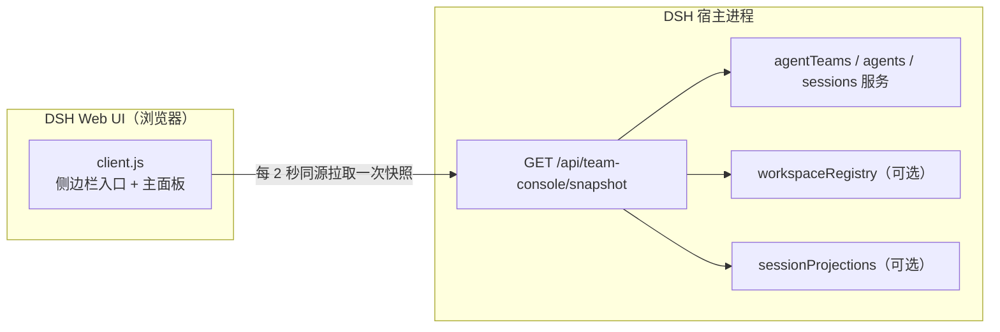

# Agent Team 看板

面向 DeepSeek Harness Web UI 的只读 Agent Teams 看板（`dsh-agent-team-console`）：在同一个主面板里按项目查看每个团队的关系图——工作区名称优先的头部、像素风 Agent 互动关系图，以及轮次、Token 与工作时间统计。

[English](README.md) | 中文

仓库地址：<https://github.com/kkomia/dsh-agent-team-console>

> **非官方社区插件。** 本仓库不属于 DeepSeek 官方包，未经 DeepSeek 发布或背书，也不替代官方实验性的 Agent Teams 套件。它只是一个只读视图：不会创建、修改或完成任何团队成员与任务。

## 为什么需要它

官方实验性的 Agent Teams Web UI（`@deepseek-ai/dsh-experimental-client-ui-agent-team`）会在对话页头部增加一个紧凑的成员花名册与任务板入口。在 Lead 会话里顺手看一眼很方便，但它不是一个独立页面。

Agent Team Console 保持同样的只读约定，并额外提供侧边栏入口和完整主面板，适合长时间运行团队的人：

- 项目筛选与紧凑状态条，覆盖进行中任务、运行成员、Token 用量、阻塞任务与待处理任务。
- 工作区名称优先的团队头部，带工作/闲置圆环以及团队轮次与 Token 合计。
- 像素风 Agent 互动关系图：Lead 位于中心，队友分布在圆环上，节点之间有 Lead 连结与消息流量连线。
- 一行式任务摘要，按需展开进行中任务，让页面保持图形化而不是大段文字。

它是一个朴素的 DeepSeek Harness（DSH）Web 插件：使用者无需构建，无 npm 依赖，不连接任何外部服务。

## 功能

- **侧边栏入口与主面板。** 侧边栏中的“团队看板”（英文界面为 “Team console”）打开主区域里的独立页面。
- **项目筛选。** 当快照中存在多个项目（工作区）时，头部会出现项目下拉框；默认值为“全部项目”，用于把状态条与团队列表收窄到某个项目。选择只保存在客户端，不会被持久化。
- **进行中优先的状态条。** 一行紧凑的状态标签：进行中任务、运行成员（运行中 / 总数）、当前选择的 Token 用量、阻塞任务（尚未就绪的待处理任务）、待处理任务。数值为 0 时仍然显示，但会弱化。
- **工作区名称优先的团队区块。** 团队按活跃优先、再按最近活动排序。每个团队头部以醒目的工作区/项目名称开头（无法解析时显示“未分组”），随后是 Lead 名称与角色、状态圆点、带“工作 · 闲置”说明的工作/闲置圆环、团队轮次、团队 Token 合计、非零时的进行中数量，以及展开/收起开关。活跃团队默认展开；空闲团队默认收起。
- **互动关系图动画。** 线性舞台被 SVG 关系图取代：Lead 位于中心枢纽，队友均匀分布在圆环上（最多 8 个，超出显示“+N”节点）。淡色的曲线 Lead 连结把 Lead 连到每个队友；曲线消息连线连接有观测到消息往来的成员——成员会话日志中的实时 `agent-message` 投递，以及存在时的旧版 `team/message/queued` 记录——均在按成员有界扫描的范围内；线宽随消息数量变化，透明度随最近时间变化，近期连线带小段流动动画表示方向。若负载没有关系数据，会自动退化为以中心成员为起点的星形结构。
- **像素风 Agent。** 每个成员都画成确定性的 SVG 矩形像素角色（10x12 模板，无外部图片）：Lead 拥有品牌色服装与标记，主题色板决定服装配色。工作占比圆环与随 Token 缩放的节点尺寸保留，每个节点下方仍有一行很小的“N 轮 · X tok”。状态动画：运行中上下浮动并闪烁工作火花，准备中旋转虚线环并柔和闪烁，未运行淡化静止，失败保留静态错误环。
- **悬停或聚焦查看成员详情。** 悬停或聚焦节点会打开紧凑详情卡，展示模型、轮次、步骤、Token 明细（未缓存输入、缓存读取、缓存写入、输出、合计）、工作与闲置时间，以及该成员的消息收发摘要。点击节点可在宿主提供工作区导航时打开该成员的会话。
- **紧凑任务摘要。** 每个团队展示一行进行中、待处理与阻塞计数，并带一个展开开关。展开后只显示进行中任务的单行行项（标题、负责人）；待处理与已完成只保留计数。阻塞遵循就绪规则：只有 `ready === false` 的待处理任务才算阻塞，进行中任务永远不会显示为阻塞。
- **动态保留在 API 中。** 快照仍为 API 消费者携带有界动态列表，但面板不再渲染它。
- **互动关系图数据。** 当宿主能提供时，快照还携带成员关系图：结构性 Lead 连线，以及从成员会话（实时投递）与 Lead 会话（旧版记录）的有界扫描聚合出的消息连线。面板始终保持只读。
- **多团队与多项目。** 每个运行中的团队一个可折叠区块；选中项目时按项目过滤。
- **如实的状态。** 首次加载显示骨架屏，失败时显示可重试的错误卡片，后续轮询失败时保留旧数据并提示“显示的是一次成功快照”，服务未挂载时显示说明，没有团队时显示空状态。
- **双语。** 所有可见文案都走 DSH 客户端 locale 服务，中英文词典保持同步；面板跟随宿主语言。
- **贴合主题。** 颜色、边框以及像素/关系图图形只使用 `--dsw-*` 主题变量，因此自动适配深色与浅色主题；关系图节点支持键盘操作，所有动画在“减少动态效果”偏好下禁用。
- **轮询刷新。** 面板挂载且标签页可见时每 2 秒刷新一次同源 JSON 快照，标签页隐藏时暂停，并提供手动刷新按钮。
- **可选跳转。** 当宿主提供 `uiWorkspace.openSession` 时，点击关系图节点会打开该成员的会话；未提供时面板保持纯只读视图。

## 环境要求与兼容性

- **DSH Web UI**：桌面应用或 Web profile 均可。插件针对 DSH `0.2.1-rc.2` 开发和测试；`package.json` 声明的 `engines.dsh` 为 `>=0.2.1-rc.2 <0.3.0-0`，该范围同时排除 0.3.0 的预发布版本。
- **同一 profile 中必须挂载官方实验性 Agent Teams 套件。** 本插件只负责展示已经存在的团队，不提供 Agent Teams 服务本身。缺少该服务时面板会显示明确的“未挂载”说明，而不会报错。
- **可选的会话投影。** 轮次、Token 用量与工作 / 闲置时间来自 DSH 内置的 `sessionStats` 与 `tokenUsage` 投影。它们是可选的：没有时面板仍会渲染关系图，统计显示短横线。
- **支持 Web 的 profile。** 下面的安装示例使用 `desktop` profile；如果你的 Web profile 名称不同（例如 `web`），请替换 `desktop`。
- **使用插件无需单独安装 Node.js。** Node.js 22.19 或更高版本只在运行本仓库测试时需要。

## 安装

下面的示例使用 `dsh plugin --profile desktop add <spec>`。如果你使用其他 Web profile，请把 `desktop` 换成实际名称。

### 通过应用内的“插件”页面安装

1. 在 DSH 桌面应用中打开 **Plugins**。
2. 选择 **Add plugin**。
3. 粘贴 `github:kkomia/dsh-agent-team-console`（npm 上发布后可改用 `dsh-agent-team-console`），确认安装。
4. 重启应用以加载宿主半区，然后打开 Web UI。

### 通过命令行安装

GitHub 仓库（当前即可使用）：

```sh
dsh plugin --profile desktop add github:kkomia/dsh-agent-team-console
```

npm 仓库（待 npm 上发布后）：

```sh
dsh plugin --profile desktop add dsh-agent-team-console
```

GitHub 安装需要通过联网解析，并且需要 Git（以及 DSH 插件管理器本身使用的 pnpm）。本仓库没有构建步骤，安装只是复制包文件。

### 激活

宿主半区会在 DSH 宿主进程启动时注册 HTTP 路由，因此**安装或升级后请重启桌面应用**；如果 Web UI 页面已经打开，再刷新页面。若只有客户端资源变化而宿主未变，刷新页面即可。

## 使用

### 打开面板

在侧边栏选择 **Team console**（中文界面为“团队看板”）。面板会立即加载一次快照，之后在可见时每 2 秒轮询一次。

### 阅读头部

头部展示页面标题与副标题（一句话描述实时关系图）、适用时的项目筛选器、实时指示点（有成员运行时脉冲）、最近一次成功更新的时间，以及一个手动刷新按钮（手动刷新期间图标旋转）。

### 按项目筛选

当快照列出多个项目（工作区）时，头部会出现项目下拉框。默认是“全部项目”；选择某个项目后，状态条、Token 合计和团队区块只反映该项目的团队，团队头部会展示各自的工作区名称。筛选只在客户端进行，不会被保存，面板重新挂载后回到“全部项目”。标题重复的项目会在选项里追加短路径尾部以便区分；无法解析项目的团队只在“全部项目”下显示。

### 阅读状态条

状态条是当前选择下的一行紧凑标签：进行中任务、运行成员（运行中 / 总数）、跨所选团队汇总的 Token 用量（紧凑格式，如 `1.2M tok`）、阻塞任务、待处理任务。阻塞标签只统计尚未就绪的待处理任务；进行中和已完成的任务永远不会被算作阻塞。数值为 0 的标签仍然显示，但会弱化。已完成任务不计入状态条，只出现在每个团队的任务摘要里。

### 阅读团队区块

团队按活跃优先、再按最近活动排序。每个团队头部以醒目的工作区/项目名称开头，随后是 Lead 名称与角色、状态圆点、带“工作 · 闲置”说明的工作/闲置圆环、团队轮次、团队 Token 合计，以及非零时的进行中数量。点击头部可展开或收起团队；活跃团队默认展开，空闲团队默认收起。面板挂载期间会保留展开状态。

### 阅读互动关系图

每个团队主体是一张 SVG 互动关系图。Lead 位于中心枢纽，其他成员均匀分布在周围的圆环上；最多绘制 8 名成员，超出的用“+N”节点表示。图上方的图例会标注出现的两种连线：

- **Lead 连结**（淡色曲线辐条）：把 Lead 连到每个队友。
- **消息连线**（品牌色曲线弦）：连接有观测到消息往来的成员——每个成员会话日志中的实时 `agent-message` 投递，以及存在时的旧版 `team/message/queued` 记录，均在按成员有界扫描的范围内。线越粗表示观察窗口内消息越多，越亮表示越新，近期连线带一小段流动动画表示方向。

成员被画成确定性的像素角色，由 SVG 矩形组成（无外部图片）：Lead 拥有品牌色服装与标记，每个队友的发型、服装配色与配饰由身份确定性生成。节点半径按 Token 用量增长（相对团队内用量最高的成员做对数缩放），外圈弧线显示工作占比，每个节点下方有一行很小的“N 轮 · X tok”。状态动画：运行中上下浮动并闪烁工作火花，准备中旋转虚线环并柔和闪烁，未运行淡化静止，失败保留静态错误环。若负载没有关系数据，会自动退化为以中心成员为起点的星形结构。动画尊重宿主的“减少动态效果”偏好。

### 阅读节点详情

悬停或聚焦节点会在关系图下方打开详情卡：模型、轮次、步骤、Token 明细（未缓存输入、缓存读取、缓存写入、输出、合计）、工作与闲置时间，以及该成员的消息收发摘要。指针或焦点离开节点时卡片关闭。

### 阅读任务摘要

每个团队主体末尾是一行摘要：进行中、待处理与阻塞计数，以及一个展开开关。展开后只显示进行中任务的紧凑单行行项（标题与负责人）；待处理与已完成任务只保留计数。就绪状态由宿主派生：待处理任务的所有阻塞项都已完成时才算就绪，只有尚未就绪的待处理任务才会被统计并显示为阻塞。进行中任务属于已被认领的工作，永远不会显示阻塞警告。

### 打开成员会话

当宿主提供工作区导航时，点击关系图节点（或聚焦后按 Enter / 空格）可打开该成员的会话。这是一项可选便利：服务不可用时节点不可点击。

### 手动刷新

头部的刷新按钮会立即请求一次快照；常规的 2 秒轮询照常继续。

### 理解其他状态

- **未挂载。** 快照路由有响应，但当前 profile 未挂载 Agent Teams 服务。面板会给出说明，页面保持为空。
- **错误。** 首次加载失败。错误卡片显示原因和重试按钮。
- **数据过期。** 成功加载后某次轮询失败。上一次的数据继续显示，并附带警告提示，直到轮询再次成功。
- **空状态。** 没有找到运行中的团队。空状态会说明：创建队友或共享任务后，它们会自动出现在这里；空闲团队也会以折叠形式保留在列表中。

## 只读与隐私

Agent Team Console 刻意保持克制：

- **只有一条只读路由。** 宿主半区仅提供 `GET /api/team-console/snapshot`；对已通过准入的请求，其他路径返回 JSON 404。不存在 POST、PUT、PATCH、DELETE 路由，处理函数也从不读取请求体。
- **不做任何修改。** 宿主与客户端都不会对团队、成员、任务或会话服务调用创建、更新、删除、认领、完成、派生（spawn）或中断操作。
- **不访问外部网络。** 面板请求的是相对路径、同源 URL。没有 CDN，没有远程字体或图片，没有遥测，也没有统计分析调用。
- **宿主不读写磁盘、不注册定时器。** 宿主半区不保存可变模块状态、不触碰文件；每个请求都用实时只读服务读取重新构建快照。
- **客户端依赖最小。** 浏览器包只从宿主模块系统 `require` 了 `react`；不导入任何 `@deepseek-ai/*` 包，也没有第三方包。
- **数据留在本地。** 快照由 Web UI 本来就持有的数据（名称、角色、状态、任务文本）组装，由本机 Harness Web 服务器（通常是回环地址）提供，只返回给本机实例的同源客户端。
- **准入与 Web UI 一致。** 宿主挂载了 DSH `connection` 服务时，路由会在执行任何路由逻辑之前请求它做请求准入：未通过 Host/Origin 围栏或浏览器会话校验的请求会收到 JSON `401`（`unauthorized`）或 `403`（`forbidden`）响应，与其它 Web UI 请求一样被拒绝；同源且已通过认证的浏览器请求会被放行。宿主未挂载该服务时，路由把准入交给该部署自身的访问控制。
- **负载有界。** 文本字段有长度上限（任务描述 2000 字符，动态文案 200 字符），快照在构造上保证 JSON 安全。

## 工作原理



### 宿主半区（`index.js`）

`index.js` 没有任何 `import` 语句，因此纯 Node 测试可以直接加载它。它导出 `inject = ['webServer']` 与 `apply(ctx)`，在 `ctx.effect(...)` 中注册 `/api/team-console` 前缀路由，卸载插件时路由随之释放。

每个请求都会先执行可选的 DSH `connection` 服务准入检查：未通过 Host/Origin 围栏或浏览器会话校验的请求会在进入任何路由逻辑之前收到 JSON 401/403。随后通过 `ctx.get(...)` 解析可选的 `agentTeams`、`agents`、`sessions`、`workspaceRegistry`、`sessionProjections` 服务。缺少 Agent Teams 时返回带 `unsupported` 原因的有效快照；否则枚举正在运行的 agent，保留角色为 Lead 的项，读取每个团队的成员与任务板，用一段有界的会话尾部补全成员信息，为每个团队解析项目，并从可选的会话投影读取每个成员的会话统计（`sessionStats` 与 `tokenUsage`）：每个成员两次有界投影读取，统计从不扫描会话日志。随后计算轮次、步骤、Token 分项、工作 / 闲置 / 墙钟时间与工作占比，按团队聚合，并构建每个团队的互动关系图：结构性 Lead 连线，加上来自两个有界来源的消息连线——每个成员会话日志中的实时 `agent-message` 投递（每个列出的成员含 Lead 各取最新 1000 条事件），以及最新 2000 条 Lead 会话事件中的旧版 `team/message/queued` 记录；权重相加，消息数上限 99，保留最新时间。最后返回契约版本 4 的 JSON 安全快照。团队按活跃优先、再按最近活动排序。聚合过程中的意外错误会变成有效的 JSON 500 响应体；未知路由返回 JSON 404。

### 客户端半区（`client.js`）

`client.js` 是通过 `window.__ModuleLoader__.load` 自注册的浏览器包，id 与包名一致，工厂函数只 `require('react')`。`apply(ctx)` 在 `ctx.effect(...)` 中注册 `agent-team-console` 命名空间下的中英文词典，然后注册 `sidebar.panellist` 条目（id 为 `team-console`，order 为 20）和 `main` 面板（key 为 `team-console`）。

面板把项目选择、每个团队的展开状态以及每个团队任务摘要的展开状态保存在本地 React state（不做持久化），渲染项目筛选器、五标签状态条，以及每个团队一个可折叠区块，头部以工作区名称开头。主体是带动画的 SVG 互动关系图与确定性像素角色，以及紧凑任务摘要；线上契约仍携带动态列表，但面板不再渲染它。所有样式、关系图图形与动画都来自一个只使用 `--dsw-*` 主题变量的 `<style>` 元素，动画在“减少动态效果”偏好下禁用，轮询保持原有的 2 秒、可见性感知与清理安全行为。

## 开发

环境要求：运行测试工具需要 Node.js 22.19 或更高版本。项目没有 npm 依赖，也没有构建步骤；`client.js` 是手工编写并直接提交的浏览器包。

```sh
node --check index.js
node --check client.js
node --test test/snapshot.test.mjs
node scripts/ci-guard.mjs
```

`npm run check` 会运行语法检查与测试，`npm test` 只运行测试。测试套件目前有 50 个测试，仅使用 Node 内置模块和伪造的 Cordis 服务，覆盖快照契约（版本 4、项目解析、活跃排序、会话统计及其可选降级，以及来自实时与旧版两种来源的互动关系图连线）、未知事件形态、JSON 安全性以及路由的 200/404/500 行为。`scripts/ci-guard.mjs` 执行 32 项检查，覆盖跨文件 DSH 接线（清单、patch、exports、客户端注册、locale 元数据，以及内嵌客户端中英文词典的键一致性）——这部分即使单元测试全部通过也可能被改坏。

要在真实应用中试用本地改动，可把包安装到某个 DSH profile（安装 spec 支持绝对本地路径），重启应用后打开面板。宿主日志行以 `[agent-team-console]` 为前缀。

想在命令行检查运行中实例的快照路由，可执行
`TEAM_CONSOLE_URL=http://127.0.0.1:10100 node scripts/verify-live.mjs`。路由可达且符合 v4 契约时退出码为 `0`；路由不可达或契约不符时为 `1`；准入把请求判为未认证时为 `2`。针对运行中的 DSH 桌面应用出现 `2` 是预期结果：路由会执行 DSH connection 准入，匿名命令行探测会在任何快照逻辑之前收到 JSON 401，而浏览器 UI 携带已认证会话，因此工作正常。该脚本只适用于你能通过准入的环境，例如你自行控制且已通过认证的部署。

## 项目结构

| 路径 | 说明 |
| --- | --- |
| [`index.js`](index.js) | 宿主半区：路由注册与快照聚合（无 import） |
| [`client.js`](client.js) | 客户端半区：自注册浏览器包（插槽、locale、面板、轮询） |
| [`cordis.patch.yml`](cordis.patch.yml) | 把插件插入 profile 加载器的 bundle patch |
| [`package.json`](package.json) | 包清单：DSH bundle/client 元数据、exports、脚本 |
| [`locale/en.json`](locale/en.json)、[`locale/zh.json`](locale/zh.json) | 插件页展示用的标题与描述元数据 |
| [`icon.svg`](icon.svg) | 插件图标 |
| [`test/snapshot.test.mjs`](test/snapshot.test.mjs) | 宿主快照契约与单元测试（`node:test`，无依赖） |
| [`scripts/ci-guard.mjs`](scripts/ci-guard.mjs) | CI 使用的跨文件 DSH 清单与接线检查 |
| [`scripts/verify-live.mjs`](scripts/verify-live.mjs) | 无依赖地校验运行中实例快照路由的探针脚本 |
| [`.github/workflows/ci.yml`](.github/workflows/ci.yml) | CI：Node 22 与 24 上的语法检查、清单守卫与测试 |
| [`.gitignore`](.gitignore) | 本地忽略文件（依赖、日志、覆盖率、环境变量文件、编辑器状态） |
| [`docs/design.md`](docs/design.md) | 公开的架构、HTTP 契约与设计说明 |
| [`CONTRIBUTING.md`](CONTRIBUTING.md) | 开发环境、约定与 PR 流程 |
| [`CHANGELOG.md`](CHANGELOG.md) | 发布记录 |
| [`LICENSE`](LICENSE) | MIT 许可证 |

## 已知限制

- **非官方且实验性。** 这是建立在实验性 Agent Teams 服务之上的社区插件，相关服务可能随 DSH 版本变化。声明的兼容范围是 `>=0.2.1-rc.2 <0.3.0-0`。
- **轮询而非推送。** 数据最多可能有约 2 秒延迟，且宿主为每个请求重新构建快照。标签页隐藏时轮询暂停。
- **只列出真实团队。** 当团队拥有多个成员或至少一个共享任务时才会出现；普通的单 agent Lead 会话不会被列出。
- **项目筛选只在客户端生效。** 它不会被保存，且当只有一个项目拥有正在运行的团队时会隐藏。无法解析项目的团队只在“全部项目”下显示，并标记为“未分组”。
- **统计是尽力而为的。** 轮次、步骤、Token 用量以及工作 / 闲置时间来自可选的会话投影；不可用时宿主输出 null，关系图与详情卡显示短横线。统计从不触发会话日志扫描。
- **动态仅保留在 API 中。** 快照仍为 API 消费者携带每个团队最多 40 条的有界动态列表，但面板不再渲染它。
- **消息连线有扫描边界。** 消息连线聚合每个成员会话日志（含 Lead）最新 1000 条事件中的实时 `agent-message` 投递，加上最新 2000 条 Lead 会话事件中的旧版 `team/message/queued` 记录。更早的流量不会被观测；实时来源只统计真正投递到成员会话的消息，旧版 queued 记录则按记录本身统计。关系图只包含结构性 Lead 连线与观测到的消息连线（不包含工具调用或任务依赖图）。
- **关系图最多展示 8 名成员。** 更大的团队显示“+N”节点，而不是展示全部成员。
- **不展示消息内容。** 不显示成员之间的消息正文；关系图只使用聚合后的消息计数。
- **跳转是可选的。** 打开成员会话依赖可选的 `uiWorkspace` 服务；没有该服务时面板保持纯查看。
- **有意不做任何控制。** 不存在派生、重命名、中断、认领、完成或删除操作；写入范围与任务描述只作为 API 中的提示信息，在这里不可操作。
- **仅限 Web UI。** 插件只影响 DSH Web 客户端，CLI 与 headless 界面不受影响。

## 许可证

[MIT](LICENSE) © 2026 kkomia。

DeepSeek Harness 及相关名称是其各自所有者的商标。本项目与 DeepSeek 无隶属关系，也未获其背书。
