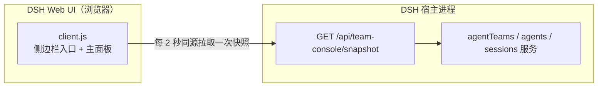

# Agent Team 看板

面向 DeepSeek Harness Web UI 的只读 Agent Teams 看板（`dsh-agent-team-console`）：在同一个主面板里实时查看成员花名册、共享任务板与协作动态。

[English](README.md) | 中文

仓库地址：<https://github.com/kkomia/dsh-agent-team-console>

> **非官方社区插件。** 本仓库不属于 DeepSeek 官方包，未经 DeepSeek 发布或背书，也不替代官方实验性的 Agent Teams 套件。它只是一个只读视图：不会创建、修改或完成任何团队成员与任务。

## 为什么需要它

官方实验性的 Agent Teams Web UI（`@deepseek-ai/dsh-experimental-client-ui-agent-team`）会在对话页头部增加一个紧凑的成员花名册与任务板入口。在 Lead 会话里顺手看一眼很方便，但它不是一个独立页面。

Agent Team Console 保持同样的只读约定，并额外提供侧边栏入口和完整主面板，适合长时间运行团队的人：

- 一眼概括团队状态的 KPI 卡片。
- Lead 优先的成员花名册，带实时状态、模型与上下文信息、最近活动。
- 全宽看板式共享任务板，展示负责人、阻塞项和提示性写入范围。
- 从 Lead 会话事件日志派生的协作动态时间线。

它是一个朴素的 DeepSeek Harness（DSH）Web 插件：使用者无需构建，无 npm 依赖，不连接任何外部服务。

## 功能

- **侧边栏入口与主面板。** 侧边栏中的“团队看板”（英文界面为 “Team console”）打开主区域里的独立页面。
- **四张 KPI 卡片。** 团队成员（运行中 / 总数）、共享任务（已完成 / 总数）、进行中任务、阻塞任务。
- **成员花名册。** Lead 单独置顶，队友以响应式网格排列。每张成员卡片展示头像首字母、角色、状态（运行中、未运行、准备中、失败）、模型、上下文模式（全新或继承）、提供方、最近活动时间与最近的会话事件类型、成员描述以及诊断信息。
- **任务板。** 三列看板（待办、进行中、已完成）并带数量。任务卡片展示状态圆点、标题、负责人、阻塞项、提示性写入范围，长描述可展开或收起；已完成卡片会淡化显示。
- **动态时间线。** 按时间倒序展示团队与任务事件，附带相对时间和类型图标。
- **多团队。** 每个正在运行的团队各占一个区块，按最近活动时间排序。
- **如实的状态。** 首次加载显示骨架屏，失败时显示可重试的错误卡片，后续轮询失败时保留旧数据并提示“显示的是一次成功快照”，服务未挂载时显示说明，没有团队时显示空状态。
- **双语。** 所有可见文案都走 DSH 客户端 locale 服务，中英文词典保持同步；面板跟随宿主语言。
- **贴合主题。** 颜色、边框和背景只使用 `--dsw-*` 主题变量，因此自动适配深色与浅色主题；尊重“减少动态效果”偏好，成员卡片支持键盘操作。
- **轮询刷新。** 面板挂载且标签页可见时每 2 秒刷新一次同源 JSON 快照，标签页隐藏时暂停，并提供手动刷新按钮。
- **可选跳转。** 当宿主提供 `uiWorkspace.openSession` 时，点击成员卡片会打开该成员的会话；未提供时面板保持纯只读视图。

## 环境要求与兼容性

- **DSH Web UI**：桌面应用或 Web profile 均可。插件针对 DSH `0.2.1-rc.2` 开发和测试；`package.json` 声明的 `engines.dsh` 为 `>=0.2.1-rc.2 <0.3.0-0`，该范围同时排除 0.3.0 的预发布版本。
- **同一 profile 中必须挂载官方实验性 Agent Teams 套件。** 本插件只负责展示已经存在的团队，不提供 Agent Teams 服务本身。缺少该服务时面板会显示明确的“未挂载”说明，而不会报错。
- **支持 Web 的 profile。** 下面的安装示例使用 `desktop` profile；如果你的 Web profile 名称不同（例如 `web`），请替换 `desktop`。
- **使用插件无需单独安装 Node.js。** Node.js 22.19 或更高版本只在运行本仓库测试时需要。

## 安装

下面的示例使用 `dsh plugin --profile desktop add <spec>`。如果你使用其他 Web profile，请把 `desktop` 换成实际名称。

### 通过应用内的“插件”页面安装

1. 在 DSH 桌面应用中打开 **Plugins**。
2. 选择 **Add plugin**。
3. 粘贴 `github:kkomia/dsh-agent-team-console`（npm 上发布后可改用 `dsh-agent-team-console`），确认安装。
4. 重启应用以加载宿主半区，然后打开 Web UI。

### 通过命令行安装

GitHub 仓库（当前即可使用）：

```sh
dsh plugin --profile desktop add github:kkomia/dsh-agent-team-console
```

npm 仓库（待 npm 上发布后）：

```sh
dsh plugin --profile desktop add dsh-agent-team-console
```

GitHub 安装需要通过联网解析，并且需要 Git（以及 DSH 插件管理器本身使用的 pnpm）。本仓库没有构建步骤，安装只是复制包文件。

### 激活

宿主半区会在 DSH 宿主进程启动时注册 HTTP 路由，因此**安装或升级后请重启桌面应用**；如果 Web UI 页面已经打开，再刷新页面。若只有客户端资源变化而宿主未变，刷新页面即可。

## 使用

### 打开面板

在侧边栏选择 **Team console**（中文界面为“团队看板”）。面板会立即加载一次快照，之后在可见时每 2 秒轮询一次。

### 阅读头部

头部展示页面标题与副标题、实时指示点（有成员运行时脉冲）、最近一次成功更新的时间，以及一个手动刷新按钮（手动刷新期间图标旋转）。

### 阅读 KPI 卡片

四张卡片概括整个快照：团队成员及运行中数量、共享任务及已完成数量、进行中任务、阻塞任务。

### 阅读成员花名册

Lead 卡片排在最前，随后是队友网格。状态药丸区分运行中、未运行、准备中和失败。元信息行展示模型、上下文模式与提供方（缺失时显示短横线），然后是最近活动时间与最近的会话事件类型。成员描述最多显示两行，诊断信息使用错误色。

### 阅读任务板

任务板分为待办、进行中、已完成三列。卡片展示任务标题、负责人标签、任务 id、阻塞信息以及提示性写入范围。长描述可以展开和收起。未阻塞的待办任务标记为“可开始”，被阻塞的任务以警告色标记。

### 阅读动态时间线

时间线按时间倒序展示所选团队最近的团队与任务事件，附带相对时间。任务操作使用本地化的动作标签：英文界面类似 “task-3 · claimed · reviewer”，中文界面类似 “task-3 · 认领 · reviewer”；服务端原始的 action 标签只出现在兜底文案里。插件无法识别的事件形态会以可读的兜底文案展示，既不会丢弃也不会抛错。

### 打开成员会话

当宿主提供工作区导航时，点击成员卡片（或聚焦后按 Enter / 空格）可打开该成员的会话。这是一项可选便利：服务不可用时卡片不可点击。

### 手动刷新

头部的刷新按钮会立即请求一次快照；常规的 2 秒轮询照常继续。

### 理解其他状态

- **未挂载。** 快照路由有响应，但当前 profile 未挂载 Agent Teams 服务。面板会给出说明，页面保持为空。
- **错误。** 首次加载失败。错误卡片显示原因和重试按钮。
- **数据过期。** 成功加载后某次轮询失败。上一次的数据继续显示，并附带警告提示，直到轮询再次成功。
- **空状态。** 没有找到运行中的团队。空状态会说明：创建队友或共享任务后，它们会自动出现在这里。

## 只读与隐私

Agent Team Console 刻意保持克制：

- **只有一条只读路由。** 宿主半区仅提供 `GET /api/team-console/snapshot`；对已通过准入的请求，其他路径返回 JSON 404。不存在 POST、PUT、PATCH、DELETE 路由，处理函数也从不读取请求体。
- **不做任何修改。** 宿主与客户端都不会对团队、成员、任务或会话服务调用创建、更新、删除、认领、完成、派生（spawn）或中断操作。
- **不访问外部网络。** 面板请求的是相对路径、同源 URL。没有 CDN，没有远程字体或图片，没有遥测，也没有统计分析调用。
- **宿主不读写磁盘、不注册定时器。** 宿主半区不保存可变模块状态、不触碰文件；每个请求都用实时只读服务读取重新构建快照。
- **客户端依赖最小。** 浏览器包只从宿主模块系统 `require` 了 `react`；不导入任何 `@deepseek-ai/*` 包，也没有第三方包。
- **数据留在本地。** 快照由 Web UI 本来就持有的数据（名称、角色、状态、任务文本）组装，由本机 Harness Web 服务器（通常是回环地址）提供，只返回给本机实例的同源客户端。
- **准入与 Web UI 一致。** 宿主挂载了 DSH `connection` 服务时，路由会在执行任何路由逻辑之前请求它做请求准入：未通过 Host/Origin 围栏或浏览器会话校验的请求会收到 JSON `401`（`unauthorized`）或 `403`（`forbidden`）响应，与其它 Web UI 请求一样被拒绝；同源且已通过认证的浏览器请求会被放行。宿主未挂载该服务时，路由把准入交给该部署自身的访问控制。
- **负载有界。** 文本字段有长度上限（任务描述 2000 字符，动态文案 200 字符），快照在构造上保证 JSON 安全。

## 工作原理



### 宿主半区（`index.js`）

`index.js` 没有任何 `import` 语句，因此纯 Node 测试可以直接加载它。它导出 `inject = ['webServer']` 与 `apply(ctx)`，在 `ctx.effect(...)` 中注册 `/api/team-console` 前缀路由，卸载插件时路由随之释放。

每个请求都会先执行可选的 DSH `connection` 服务准入检查：未通过 Host/Origin 围栏或浏览器会话校验的请求会在进入任何路由逻辑之前收到 JSON 401/403。随后通过 `ctx.get(...)` 解析可选的 `agentTeams`、`agents`、`sessions` 服务。缺少 Agent Teams 时返回带 `unsupported` 原因的有效快照；否则枚举正在运行的 agent，保留角色为 Lead 的项，读取每个团队的成员与任务板，用会话活动补全成员信息，把团队与任务事件归一化为时间线条目，最后返回一个 JSON 安全的契约版本 1 文档。聚合过程中的意外错误会变成有效的 JSON 500 响应体；未知路由返回 JSON 404。

### 客户端半区（`client.js`）

`client.js` 是通过 `window.__ModuleLoader__.load` 自注册的浏览器包，id 与包名一致，工厂函数只 `require('react')`。`apply(ctx)` 在 `ctx.effect(...)` 中注册 `agent-team-console` 命名空间下的中英文词典，然后注册 `sidebar.panellist` 条目（id 为 `team-console`，order 为 20）和 `main` 面板（key 为 `team-console`）。

面板渲染一个只使用 `--dsw-*` 主题变量的 `<style>` 元素，因此样式会随面板一起卸载。面板挂载且标签页可见时每 2 秒轮询同源快照，带有在途请求保护，卸载时中止活动请求，并且不会在 React effect 之外挂载全局监听器。宿主每次请求都重新构建快照，因此无需推送通道也能保持接近实时的数据；同时只读约束仍然容易审计：两个半区里都不存在修改类调用。

## 开发

环境要求：运行测试工具需要 Node.js 22.19 或更高版本。项目没有 npm 依赖，也没有构建步骤；`client.js` 是手工编写并直接提交的浏览器包。

```sh
node --check index.js
node --check client.js
node --test test/snapshot.test.mjs
node scripts/ci-guard.mjs
```

`npm run check` 会运行语法检查与测试，`npm test` 只运行测试。测试仅使用 Node 内置模块和伪造的 Cordis 服务，覆盖快照契约、未知事件形态、JSON 安全性以及路由的 200/404/500 行为。`scripts/ci-guard.mjs` 检查跨文件的 DSH 接线（清单、patch、exports、客户端注册、locale 元数据）——这部分即使单元测试全部通过也可能被改坏。

要在真实应用中试用本地改动，可把包安装到某个 DSH profile（安装 spec 支持绝对本地路径），重启应用后打开面板。宿主日志行以 `[agent-team-console]` 为前缀。

想在命令行检查运行中实例的快照路由，可执行
`TEAM_CONSOLE_URL=http://127.0.0.1:10100 node scripts/verify-live.mjs`。路由可达且符合 v1 契约时退出码为 `0`；路由不可达或契约不符时为 `1`；准入把请求判为未认证时为 `2`。针对运行中的 DSH 桌面应用出现 `2` 是预期结果：路由会执行 DSH connection 准入，匿名命令行探测会在任何快照逻辑之前收到 JSON 401，而浏览器 UI 携带已认证会话，因此工作正常。该脚本只适用于你能通过准入的环境，例如你自行控制且已通过认证的部署。

## 项目结构

| 路径 | 说明 |
| --- | --- |
| [`index.js`](index.js) | 宿主半区：路由注册与快照聚合（无 import） |
| [`client.js`](client.js) | 客户端半区：自注册浏览器包（插槽、locale、面板、轮询） |
| [`cordis.patch.yml`](cordis.patch.yml) | 把插件插入 profile 加载器的 bundle patch |
| [`package.json`](package.json) | 包清单：DSH bundle/client 元数据、exports、脚本 |
| [`locale/en.json`](locale/en.json)、[`locale/zh.json`](locale/zh.json) | 插件页展示用的标题与描述元数据 |
| [`icon.svg`](icon.svg) | 插件图标 |
| [`test/snapshot.test.mjs`](test/snapshot.test.mjs) | 宿主快照契约与单元测试（`node:test`，无依赖） |
| [`scripts/ci-guard.mjs`](scripts/ci-guard.mjs) | CI 使用的跨文件 DSH 清单与接线检查 |
| [`scripts/verify-live.mjs`](scripts/verify-live.mjs) | 无依赖地校验运行中实例快照路由的探针脚本 |
| [`.github/workflows/ci.yml`](.github/workflows/ci.yml) | CI：Node 22 与 24 上的语法检查、清单守卫与测试 |
| [`.gitignore`](.gitignore) | 本地忽略文件（依赖、日志、覆盖率、环境变量文件、编辑器状态） |
| [`docs/design.md`](docs/design.md) | 公开的架构、HTTP 契约与设计说明 |
| [`CONTRIBUTING.md`](CONTRIBUTING.md) | 开发环境、约定与 PR 流程 |
| [`CHANGELOG.md`](CHANGELOG.md) | 发布记录 |
| [`LICENSE`](LICENSE) | MIT 许可证 |

## 已知限制

- **非官方且实验性。** 这是建立在实验性 Agent Teams 服务之上的社区插件，相关服务可能随 DSH 版本变化。声明的兼容范围是 `>=0.2.1-rc.2 <0.3.0-0`。
- **轮询而非推送。** 数据最多可能有约 2 秒延迟，且宿主为每个请求重新构建快照。标签页隐藏时轮询暂停。
- **只列出真实团队。** 当团队拥有多个成员或至少一个共享任务时才会出现；普通的单 agent Lead 会话不会被列出。
- **动态是派生的。** 时间线来自对 Lead 会话团队与任务事件的有界读取：宿主最多组装 40 条，面板展示最新的 12 条。无法识别的事件形态会退化为通用文案。
- **没有消息时间线。** 不展示成员之间的消息；官方花名册与任务板仍是事实来源。
- **跳转是可选的。** 打开成员会话依赖可选的 `uiWorkspace` 服务；没有该服务时面板保持纯查看。
- **有意不做任何控制。** 不存在派生、重命名、中断、认领、完成或删除操作，写入范围只作为提示信息展示。
- **仅限 Web UI。** 插件只影响 DSH Web 客户端，CLI 与 headless 界面不受影响。

## 许可证

[MIT](LICENSE) © 2026 kkomia。

DeepSeek Harness 及相关名称是其各自所有者的商标。本项目与 DeepSeek 无隶属关系，也未获其背书。
