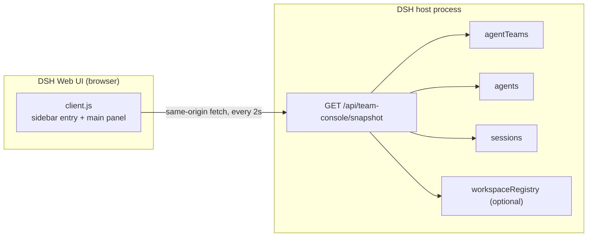

# Agent Team Console: design notes

Public design notes for the `dsh-agent-team-console` plugin, version 1.1.0 (snapshot contract version
2). This document describes the architecture, the HTTP snapshot contract, the in-progress-first UI
model, the polling lifecycle, the theme and accessibility model, and the current limitations. It is
written for people who want to understand or extend the plugin; user-facing instructions live in
[the README](../README.md).

## 1. Overview and goals

Agent Team Console is a read-only dashboard for Agent Teams in the DeepSeek Harness (DSH) Web UI. It
adds a sidebar entry and a first-class main panel that shows, for every live team:

- team-level counts in a compact status strip, scoped by an optional project filter;
- a compact active-first roster with status, model, and recent activity;
- shared tasks grouped in-progress first, with owners, blockers, and advisory write scopes;
- a compact activity list of member and task events.

The goals that shaped the design:

1. **Zero friction.** A plain DSH Web bundle with no build step, no npm dependencies, and no external
   services. The host half imports nothing; the client half borrows only React from the host.
2. **Read-only by construction.** There is no mutation path to audit away: one read-only HTTP route,
   no request bodies, no write calls, no host timers, no filesystem access.
3. **In-progress first.** The panel leads with what is happening now: active teams expand, in-progress
   tasks come first, and idle or completed work collapses or shrinks out of the way.
4. **Project-scoped.** A one-glance project filter keeps a multi-workspace setup scannable without
   adding configuration or persistence.
5. **Native look and feel.** The panel uses DSH theme tokens and typography so it follows the host's
   dark and light themes, plus the panel's own accessibility conventions.
6. **Defensive data handling.** The Agent Teams services are experimental; their views may change.
   Unknown or malformed payloads must degrade to a readable fallback instead of throwing.
7. **Bilingual.** Every visible string goes through the DSH client locale service, with Chinese and
   English dictionaries kept key-for-key in sync.

## 2. Non-goals

- Replacing the official experimental Agent Teams bundle. This plugin does not provide the Agent
  Teams service, the team tools, or the model-facing behavior.
- Creating, spawning, renaming, interrupting, claiming, completing, deleting, or reassigning anything.
- A message or mailbox timeline. Peer messages are not shown.
- Push-based updates. The panel polls; there is no stream, WebSocket, or projection subscription.
- A build pipeline, a bundler, a test framework, or runtime dependencies.
- Anything on the CLI or headless surfaces; this is a Web UI plugin.

## 3. Why a snapshot endpoint instead of the client projection

The official Agent Teams Web UI reads the `agentTeam` client projection through host Client packages.
A self-contained plain-JS bundle cannot import those packages, so it cannot read the projection
directly.

This plugin takes a different route that is fully within the public plugin surface:

1. The **host half** aggregates the live view from the ordinary Host services `agentTeams`, `agents`,
   and `sessions`, optionally resolves project/workspace data through the `workspaceRegistry` service,
   and exposes it as one JSON document over a same-origin HTTP route.
2. The **client half** fetches that document from the browser and renders it.

The pattern is common for small DSH Web plugins: register a route on the Web server, then `fetch` it
from the same origin. It keeps the client bundle dependency-free, and it makes the read-only
guarantee easy to verify: the browser can only read the snapshot route, and that route only calls
read methods on the services.

## 4. Architecture



The two halves are independent files with independent lifecycles:

| Half | File | Loaded by | Responsibility |
| --- | --- | --- | --- |
| Host | `index.js` | the DSH host plugin loader (Cordis bundle) | Register the HTTP route; build the version 2 JSON snapshot per request from live services. |
| Client | `client.js` | the DSH Web module loader | Register locale dictionaries, the sidebar entry, and the main panel; poll, filter by project, and render the active-first snapshot. |

The package manifest wires both halves: `dsh.bundle.patch` points at `cordis.patch.yml`, which
inserts the bundle row into the profile loader, and `exports["./client"]` points at the browser
bundle that the Web client loads. The browser half also declares its platform (`dsh.client.platform:
"web"`), its immediate mount flag (`dsh.client.immediately: true`), and its client-module dependency
on the locale package.

## 5. HTTP contract

### 5.1 Route and response basics

- Route: `GET /api/team-console/snapshot` only, registered under the `/api/team-console` prefix.
- Content type: `application/json; charset=utf-8`.
- Cache headers: `cache-control: no-store`. The client also sends `cache: 'no-store'`.
- Admission: when the host mounts the DSH `connection` service, the handler calls its request
  admission check (`connection.requestRejection(req)`) before any routing, so the route enforces the
  same Host/Origin fence and browser-session admission as the rest of the Web UI. A rejected request
  receives a JSON `401` (`unauthorized`) or `403` (`forbidden`) response with the usual JSON content
  type and no-store cache header, before any snapshot work. When the service is not mounted, the route
  leaves admission to the deployment's own access control. The handler adds no other authentication
  mechanism and no cross-origin access.
- The handler never reads the request body and never rejects. Request method and path come from
  `req.url`, parsed against a local base URL.

### 5.2 Snapshot document

Contract version 2 (`VERSION = 2`). A healthy response is HTTP 200 with:

```jsonc
{
  "version": 2,
  "ok": true,
  "generatedAt": 1730000000000,          // Date.now() at the host when the snapshot was built
  "unsupported": null,                    // string when Agent Teams services are absent
  "totals": {
    "teams": 2,
    "activeTeams": 1,
    "members": 5,
    "running": 2,
    "tasks": 7,
    "pending": 3,
    "inProgress": 2,
    "blocked": 1,
    "completed": 2
  },
  "projects": [
    {
      "id": "workspace-id",               // workspace id, or "cwd:<path>" for the fallback project
      "title": "team",                    // workspace title, else the directory basename
      "path": "/path/to/team",            // workspace path, else Lead session cwd, else null
      "teams": 2,
      "activeTeams": 1,
      "running": 2,
      "inProgress": 2
    }
  ],
  "teams": [
    {
      "id": "session-abc",                // String(team root session id); also the Lead id
      "error": null,                      // string if roster or task reads failed for this team
      "project": { "id": "workspace-id", "title": "team", "path": "/path/to/team" },
      "active": true,                     // running/provisioning member or in-progress task
      "counts": {
        "members": 3,
        "running": 1,
        "provisioning": 0,
        "failed": 0,
        "idle": 2,
        "tasks": 4,
        "pending": 1,
        "inProgress": 2,
        "completed": 1,
        "blocked": 1,
        "ready": 1
      },
      "members": [
        {
          "id": "session-abc",
          "name": "lead",
          "role": "lead",                 // "lead" | "teammate"
          "status": "running",            // "running" | "inactive" | "provisioning" | "failed"
          "description": "Coordinates the team.",
          "provider": "deepseek",         // string | null (best effort)
          "model": "deepseek-flash",      // string | null (best effort)
          "context": "fresh",             // "fresh" | "fork" | null
          "diagnostics": [],
          "lastActivityAt": 1730000000000, // number | null (epoch milliseconds)
          "lastEventType": "tool/result", // string | null (raw session event type)
          "turns": 7,                     // number | null
          "steps": 21,                    // number | null
          "active": true                  // running or provisioning
        }
      ],
      "tasks": [
        {
          "id": "task-1",
          "revision": 2,
          "subject": "Write the client panel",
          "description": "...",           // capped at 2000 characters
          "status": "in_progress",        // "pending" | "in_progress" | "completed"
          "ownerName": "reviewer",        // string | null
          "blockedBy": ["task-2"],       // retained dependency ids; presence alone is not a blocked state
          "ready": false,                // ready = pending && all blockers completed; false for non-pending
          "writeScopes": ["client.js"],
          "writeScopeWarnings": [],
          "active": true                  // status === "in_progress"
        }
      ],
      "activity": [
        {
          "seq": 42,
          "time": 1730000000000,
          "kind": "task",                 // "member" | "task"
          "action": "claim",              // short machine label
          "memberName": "reviewer",       // string | null where derivable
          "taskId": "task-3",             // string | null where derivable
          "subject": "Review the diff",   // string | null where derivable
          "status": "in_progress",        // string | null where derivable
          "text": "task-3 · claim · Review the diff" // required human-readable fallback
        }
      ]
    }
  ]
}
```

`project` is `null` when the workspace could not be resolved; such teams still appear in `teams` and
under the client's all-projects filter, but they are never grouped into `projects[]`.

Readiness is derived by the host runtime: `ready` is true only when the task is pending and all of its
blockers are completed. A pending task can therefore be ready while its retained `blockedBy` list
still names the completed blockers. In-progress and completed tasks always have `ready: false`, but
they are claimed or finished work, not blocked work; only pending tasks can be shown as blocked, and
the blocked marker carries the blocker ids when they are known.

### 5.3 Field rules

- **IDs are strings.** Branded ids are converted with `String(...)`; missing ids become `""`, never
  `undefined`.
- **No `undefined` in JSON.** `undefined`, functions, symbols, non-finite numbers, and circular
  references become `null`. The snapshot is assembled through one JSON-safety pass (`toJsonSafe`), so
  it round-trips through `JSON.stringify` / `JSON.parse` unchanged.
- **Caps.** Task descriptions are capped at 2000 characters; activity labels at 200 characters.
- **Active flags.** A team is active when `counts.provisioning > 0`, `counts.running > 0`, or
  `counts.inProgress > 0`. A member is active when its status is `running` or `provisioning`. A task
  is active when its status is `in_progress`. The flags are computed on the host and echoed as
  component-level `active` booleans.
- **Readiness.** The runtime derives `ready` as `status === "pending" && all blockers completed`.
  Consequently every in-progress and completed task has `ready: false` and is never described as
  blocked. `blockedBy` is retained dependency metadata, so a pending task may be ready while the list
  still names its completed blockers. Only pending tasks can be shown as blocked, and a blocked
  pending task names its blocker ids when they are known.
- **Team visibility.** A team is listed only when it has more than one member or at least one shared
  task. Every ordinary runtime root is an implicit one-person Lead; without this filter, unrelated
  single-agent sessions would appear as teams.
- **Ordering.** `teams` is ordered active first (descending), then by most recent observed activity
  descending. Within a team, the Lead is first and teammates follow in roster order. Tasks keep the
  service's creation order with deleted tasks omitted. Activity is newest first. `projects` is ordered
  by `activeTeams` descending, then `teams` descending, then `title` ascending.
- **Counts.** Per-team counts keep the version 1 names and add `idle` (inactive members) and `ready`
  (pending tasks that are ready to start, i.e. `ready === true`). `blocked` counts pending tasks that
  are not ready (`ready === false`), which means at least one blocker is still open; in-progress and
  completed tasks are never counted as blocked. `inProgress` and `completed` count tasks by status;
  member status counts are exclusive.
- **Totals.** `totals.teams` counts the listed teams and `totals.activeTeams` the active ones; member
  and task counters are sums over the listed teams. Version 2 adds `activeTeams`, `pending`,
  `inProgress`, and `blocked`; `teams`, `members`, `running`, `tasks`, and `completed` already existed
  in version 1.
- **Projects.** `projects[]` contains only projects that own at least one listed team; teams with no
  resolvable project are not grouped into a virtual project. Each project entry aggregates the listed
  teams with the same project id. Resolution is best effort and never throws:
  1. take the Lead session (`sessions.get(teamId)`) and read its immutable creation-header `cwd` when
     that is a non-empty string;
  2. ask the optional `workspaceRegistry` service for `list()`, whose entities expose
     `{ id, path, title, sessionIds }`; an entity whose `sessionIds` includes the Lead session id wins,
     otherwise an entity whose path matches the Lead cwd (case-insensitive across `/` and `\`)
     is used;
  3. when there is no workspace entity but there is a cwd, fall back to a synthetic
     `id: "cwd:<cwd>"` project whose `title` is the directory basename and whose `path` is the cwd;
  4. with neither a workspace nor a cwd, set `project: null` and keep the team listed.
- **Unsupported runtime.** When the Agent Teams service is missing, or exists but does not expose
  the expected methods, the response is still `200`, still `version: 2`, still `ok: true`, with
  `unsupported` set to a short reason string (for example, `"Agent Teams service is not mounted"`)
  and empty `teams` and `projects` arrays.
- **Per-team errors.** If reading one team's roster or task board throws, that team is still returned
  with `error` set and whatever data was readable; other teams are unaffected.
- **Contract evolution.** Version 2 adds fields to the version 1 shape; it does not remove or rename
  existing ones. The bundled client reads every field defensively and keeps local fallbacks for
  `active` and the new counters, so a partial or older payload still renders.

### 5.4 Error responses

- Admission rejection: HTTP 401 with
  `{ "version": 2, "ok": false, "error": "unauthorized", "teams": [] }`, or HTTP 403 with
  `"error": "forbidden"`, written before routing when the DSH `connection` service rejects the
  request. Admission runs first, so an unauthenticated request never reaches the 404/500 paths below.
- Unknown method or path: HTTP 404 with
  `{ "version": 2, "ok": false, "error": "unknown ...", "teams": [] }`.
- Unexpected aggregation failure: HTTP 500 with
  `{ "version": 2, "ok": false, "error": "...", "teams": [] }`.
- A response object that cannot be written to is handled defensively; the handler never throws or
  rejects into the Web server.

## 6. Host half

`index.js` is deliberately plain: **zero `import` statements**, so a dependency-free Node test can
import and exercise its exported helpers directly.

### 6.1 Registration and lifecycle

```js
export const inject = ['webServer']

export function apply(ctx) {
  // ... guard the webServer service and ctx.effect ...
  ctx.effect(() => ctx.webServer.register({
    kind: 'prefix',
    path: '/api/team-console',
    handler: createRouteHandler(ctx),
  }), 'agent-team-console: /api/team-console route')
}
```

- `webServer` is the only required service. If it is missing, `apply` logs once and registers
  nothing; it never throws.
- The optional `connection` service is resolved per request and used for admission (see 5.1). It is
  not required; on a host without it the route leaves admission to the deployment's own access
  control.
- The optional `workspaceRegistry` service is resolved per request and listed once per snapshot for
  project resolution. It is not required: a missing, throwing, or malformed registry degrades to the
  Lead session cwd fallback (see 5.3).
- Registration happens inside `ctx.effect(...)`, so unloading the plugin disposes the route.
- The Agent Teams services are optional and are resolved per request with `ctx.get(...)`, guarded at
  every use. They are never captured at load time, so a service that mounts later is picked up on the
  next request.

### 6.2 Aggregation pipeline

Per request, the route handler first applies admission (see 5.1); only admitted requests reach the
snapshot builder. `createSnapshot(ctx)` then:

1. Resolves `agentTeams`, `agents`, and `sessions`; computes an `unsupported` reason if the required
   Agent Teams API is not present.
2. Lists the optional `workspaceRegistry` entities once for the whole snapshot (guarded; an absent or
   failing registry simply yields no workspaces).
3. Enumerates live agents through `agents.list()` and asks `agentTeams.tryMembership(agent)` for each
   one. Agents whose membership role is not `lead` are skipped; team ids are deduplicated.
4. For each team, reads the roster (`listMembers`) and the task board (`listTasks`) inside
   per-call try/catch, normalizes rows, and makes sure a Lead row exists (synthesizing one from the
   root agent status when the roster does not carry it).
5. Decides whether the team is listable (more than one member or at least one task). Cheap counts are
   computed first, so the more expensive session reads are skipped for implicit one-person Leads.
6. Enriches members from the `sessions` service, normalizes team activity from the Lead session's
   event log, and resolves the team's `project` (workspace entity first, cwd fallback, else `null`).
7. Computes the per-team counts and `active` flag, plus the `activityAt` sort key (the latest member or
   activity timestamp). Sorts teams active first and then by `activityAt` descending, aggregates
   `totals` and `projects`, and returns the JSON-safe document.

### 6.3 Member enrichment from sessions

For each member, the host reads a bounded tail of that member's session events (at most 60 trailing
events) and fills in:

- `lastActivityAt` and `lastEventType` from the newest event;
- `turns` from the highest `turn/start` event seen;
- `steps` from the highest `step/start` event seen;
- `provider` and `model` from the session request header's `config` when the roster view did not
  carry them.

All of these reads are best effort. A missing session, a throwing accessor, or an unexpected event
shape leaves the fields `null`.

### 6.4 Activity normalization

The activity list is built only from the Lead session log, and only from the two event types owned by
the Agent Teams projection: `team/member` and `team/task`.

- The parser accepts both the projection's wrapped payload (`{ member: {...} }`, `{ task: {...} }`)
  and a flat payload, so minor shape changes degrade instead of failing.
- `team/member` phases map to actions and statuses: `provisioning` to `spawn`/`provisioning`,
  `active` to `start`/`running`, `failed` to `fail`/`failed`; anything else becomes a generic update.
- `team/task` events derive an action from the revision and status: a first revision is a creation, a
  `completed` status completes, `deleted` deletes, `in_progress` claims, a return to `pending`
  releases or reopens depending on the previous status, and everything else is an update. Owner ids
  are resolved to member names when possible.
- Every entry carries a `text` fallback built from the id, action, and subject, capped at 200
  characters. The client can always render something even for a future event shape.
- Events are filtered by team id when the payload carries one, capped to the newest 40 entries, and
  returned newest first. The client renders at most the newest 8.
- To keep long-running Lead sessions cheap, the scan starts with the newest 400 events and expands by
  a factor of 4 until it has at least 12 activity entries, reaches the start of the log, or hits the
  20000-event ceiling.

### 6.5 Project resolution

Every listed team gets a `project` object or `null`, resolved best effort from two optional sources:

1. **Workspace registry.** `workspaceRegistry.list()` is called once per snapshot. Entities are
   expected to expose `{ id, path, title, sessionIds }` synchronously. A `sessionIds` match on the Lead
   session id wins; otherwise a workspace `path` equal to the Lead session cwd (case-insensitive with
   `/` and `\` unified) is used.
2. **Cwd fallback.** When no workspace entity matches but the Lead session has a non-empty creation
   header `cwd`, the host synthesizes `{ id: "cwd:<cwd>", title: <basename>, path: <cwd> }`. Windows
   separator spellings, trailing separators, and drive roots are handled; a drive root falls back to
   the path itself as the title.
3. **No project.** When neither a workspace nor a cwd is available, `project` is `null`. The team is
   still listed and the client shows it under the all-projects filter only.

Resolution is wrapped in try/catch and every registry read is guarded separately, so a single
malformed entity or a throwing registry accessor degrades to the fallback instead of failing the
snapshot.

### 6.6 Defensive parsing and JSON safety

The host treats every service view and event payload as untrusted:

- Row normalization uses copy-and-coerce helpers; wrong types become `null`, empty strings, or empty
  lists; deleted task tombstones are dropped; unknown statuses fall back to `pending`.
- Project resolution never throws: missing services, throwing accessors, malformed entities, and odd
  path spellings all degrade to the cwd fallback or `null`.
- Event normalization is wrapped so even an unexpected shape produces a generic fallback entry
  rather than an exception.
- The completed snapshot goes through `toJsonSafe`, which deep-copies only JSON-representable values,
  converts bigints to strings, and breaks cycles with `null`.
- The route wraps aggregation in try/catch and turns an unexpected failure into a valid JSON 500.

### 6.7 Bounded work and no side effects

- The host keeps no mutable module state, starts no timers, monitors nothing, and touches no files.
- Every request rebuilds the snapshot from read-only service reads; concurrent requests cannot
  corrupt each other.
- All reads are bounded: 60 trailing events per member for enrichment, a 400-to-20000 event window for
  activity, 40 activity entries per team, and capped text fields in the output.
- Project resolution adds one synchronous workspace-registry `list()` per snapshot and at most a
  handful of synchronous entity reads; the request path never awaits or calls async registry APIs.

## 7. Client half

`client.js` is a self-registering classic browser bundle. Nothing compiles it, and it has no module
imports of its own.

### 7.1 Registration

```js
window.__ModuleLoader__.load({
  id: 'dsh-agent-team-console',          // must equal the package name
  factory: (require) => {
    const React = require('react')        // the only allowed dependency
    // ... components ...
    return {
      inject: ['slots', 'locale'],
      apply(ctx) {
        // locale dictionaries, then slot registrations
      },
    }
  },
})
```

`apply(ctx)`:

- Reads the optional `locale` service. If present, it registers the `zh` and `en` dictionaries under
  the `agent-team-console` namespace inside `ctx.effect(...)` and binds `t` to that namespace. If the
  service is absent, the bundle falls back to its built-in Chinese dictionary so the panel still
  renders.
- Resolves the `slots` service and registers:
  - a `sidebar.panellist` entry with id `team-console`, order 20, a label resolved through `t(...)`,
    and the panel icon component;
  - a `main` panel with key `team-console`.
- Registers nothing outside the plugin's own slot tree, writes nothing to `document.body`, and
  attaches no global listeners outside React effects. Unloading the plugin removes the slot entries
  and disposes the locale registrations.

### 7.2 Locale

All visible copy comes from a `t(key, params)` function. The bundle carries complete `zh` and `en`
dictionaries with identical key sets; placeholder interpolation is handled by the locale service when
present, or by a tiny local fallback. A locale subscription re-renders the panel when the host
language changes, and times and dates use the active language tag (`zh-CN` or `en-US`).

### 7.3 Polling and state machine

- Cadence: `POLL_MS = 2000` while the panel is mounted and `document.visibilityState` is `visible`.
- Request: relative URL `/api/team-console/snapshot`, `credentials: 'same-origin'`,
  `cache: 'no-store'`, `accept: application/json`.
- An in-flight guard prevents overlapping requests; a manual refresh is skipped while a request is
  running.
- An `AbortController` per request is aborted on unmount; the interval and the `visibilitychange`
  listener are removed on unmount.
- When the tab becomes visible again, the panel loads immediately instead of waiting for the next
  tick.

The hook keeps one state object:

| State | Trigger | What the panel shows |
| --- | --- | --- |
| `loading` with no data | first mount | header + skeleton blocks, no layout jump |
| `ok` | successful response | status strip, team sections |
| `ok` + `stale` | a later poll failed | last data stays visible with a reconnect hint |
| `error` with no data | first load failed | error card with the message and a retry button |
| `refreshing` | manual refresh in flight | refresh icon spins; data stays visible |

An `ok: false` body is treated as a failure. A successful response also updates the last-updated
clock. The panel treats every field defensively: missing or wrongly typed values fall back to empty
lists, `null`, or a dash.

### 7.4 Rendering

The panel renders, in order:

1. A `<style>` element with the panel's styles, tagged with a data attribute so it is easy to spot and
   disposed together with the panel.
2. The page header: title, subtitle, project filter (only when more than one project is listed), live
   indicator (pulsing while any member is running), the last updated time, and a manual refresh
   button.
3. Optional banners: a stale-data hint, an unsupported-service notice.
4. The compact status strip: four chips (in-progress tasks, running members, blocked tasks, pending
   tasks) computed over the currently filtered teams; zero values are muted rather than hidden.
5. Either the empty state, or one collapsible section per filtered team.

The project filter is a native `<select>` with an `aria-label`. It starts at "All projects" and is
rendered only when `projects[]` has more than one entry. Choosing a project filters the status strip
and the team sections locally, without another request. Duplicate project titles are disambiguated
with a short unique path tail in the option label; the filter is not persisted and resets when the
panel remounts.

Each team section has an always-visible header and a collapsible body. The header shows a status dot,
the project chip when known, the Lead name and role, in-progress, member, and blocked counters (blocked
only when non-zero), the last activity time, and an expand/collapse control with `aria-expanded` and
`aria-controls`. Active teams are expanded by default; idle teams are collapsed by default. Expansion
state is local React state keyed by team id and persists for the mounted panel.

The body renders, in order:

1. A compact wrapping roster of member chips, active members first (running/provisioning, then idle,
   then failed). Each chip shows the avatar initial, name, role tag, and a status dot with its label;
   the model and last activity live in the tooltip. At most 8 members are rendered, with an "N more"
   chip when the roster is longer.
2. Task sections in-progress first: in-progress task cards (the strongest visual block, with subject,
   owner, advisory write scopes, and an expandable description; they carry no blocked warning),
   compact pending one-line rows (a ready marker when `ready === true`; otherwise a blocked marker
   with the blocker ids when known), and a collapsed "Completed N" toggle per team that reveals dimmed
   one-line rows.
3. A compact activity list of at most 8 entries, newest first: relative time plus a composed label
   (`task id · localized action · member`, falling back to the server-provided `text`); the entry
   tooltip carries the subject and the short local date. Action labels are localized through the
   dictionaries (`action.claim` reads "claimed" in English and "认领" in Chinese); the raw server-side
   action label appears only in fallback text.

In-progress and completed tasks always report `ready: false`, so the panel never renders a blocked
marker for them; only pending tasks can be shown as ready or blocked.

The status strip and the team list both reflect the selected project; the empty state appears when the
selection has no teams. Relative time thresholds: under 5 seconds is "just now"; under a minute shows
seconds; then minutes, hours, and days; seven days or more falls back to a short localized date.
Hovering a time shows the short local date.

### 7.5 Optional navigation

When the optional `uiWorkspace` service exposes `openSession`, clicking a member chip opens that
member's session. Member chips become keyboard-focusable buttons in that case. Navigation is wrapped
in try/catch and never affects rendering; without the service the roster is a pure read-only view.

### 7.6 Styling and theming

One `<style>` element in the panel render owns all panel CSS; class names are prefixed `atc-`. Colors,
borders, and backgrounds come exclusively from DSH alias tokens:

`--dsw-alias-bg-base`, `--dsw-alias-bg-layer-1`, `--dsw-alias-bg-layer-2`, `--dsw-alias-bg-overlay`,
`--dsw-alias-border-l1`, `--dsw-alias-border-l2`, `--dsw-alias-brand-primary`,
`--dsw-alias-label-primary`, `--dsw-alias-label-secondary`, `--dsw-alias-state-idle-primary`,
`--dsw-alias-state-success-primary`, `--dsw-alias-state-warn-primary`,
`--dsw-alias-state-error-primary`.

Counts and times use `font-variant-numeric: tabular-nums` so values do not jitter while polling.
`color-mix()` is used only to derive translucent status tints from those same tokens. The filter,
status strip, and team headers are one-line chip components with 1 px token borders; in-progress
blocks use the brand tint and border, blocked markers use the warning color, and idle or completed
content is muted. No gradients, no drop shadows, no hardcoded colors.

### 7.7 Accessibility

- The live indicator is a polite live region; status is also conveyed by text, not only color.
- The project filter is a native `<select>` with a localized `aria-label`, and the refresh button has
  a localized `aria-label` plus `aria-busy` while loading.
- Error cards use `role="alert"`; stale and unsupported notices use `role="status"`.
- Each team header is a button with `aria-expanded` and `aria-controls`; the completed-tasks toggle is
  a button with `aria-expanded` and a localized `aria-label`; the roster is a labeled `role="group"`.
- Member chips are buttons with a descriptive `aria-label` when session navigation is available, and
  the task description toggles expose `aria-expanded`.
- Decorative SVGs and status dots are `aria-hidden`; screen-reader-only text carries expand/collapse
  labels; focus-visible outlines use the brand token.
- `prefers-reduced-motion: reduce` disables the pulse, spin, skeleton, and caret transitions.

## 8. Visual design

The target is a calm, dense "mission control" page that looks native to the Harness Web UI rather than
a chat toy. Version 1.1 moved from a card-grid dashboard to an in-progress-first, single-screen layout.

- **Page:** scroll container on the base background; content max-width 1120 px centered; 20-24 px
  padding on wide screens; 14 px between page blocks.
- **Typography:** 13 px body, 12 px meta text, 18 px page title, 600-weight section titles, 10-11 px
  uppercase role tags.
- **Components:** compact chips, one-line headers, 1 px token borders, 8-10 px radius, layer-1
  backgrounds; 8-10 px inner gaps.
- **Status strip:** one row of four inline chips with 13 px semibold tabular values; in-progress uses
  the brand color, running uses success, blocked uses warning, and zero values are muted.
- **Team sections:** collapsible cards; the header is a single row of dot, project chip, Lead, counters,
  last activity, and caret; the body adds 2-12 px padding; the active section uses the stronger border
  token.
- **Roster:** a wrapping row of pill chips with 18 px avatars; idle chips are muted and failed chips get
  an error-tinted border.
- **Tasks:** in-progress cards carry a brand left border and tint; pending and completed rows are
  compact one-line lists separated by 1 px borders, and completed rows are dimmed.
- **Activity:** the smallest visual weight: an 11.5 px one-line list with a fixed 64 px relative-time
  column.

Responsive behavior: below 900 px the page padding shrinks, the header side takes the full row width,
the project select can stretch, and the activity time column narrows; the layout is otherwise a single
column by design and needs no stacking breakpoints. No element relies on hover to be usable.

## 9. Privacy and security posture

- **Read-only surface.** The host exposes exactly one read route. There is no POST/PUT/PATCH/DELETE
  handling, no request body parsing, and no mutation call anywhere in either half.
- **Local data only.** The snapshot is assembled from data the Web UI already holds and is served by
  the local Harness Web server, typically on a loopback address, only to same-origin clients of the
  local instance. There are no external requests, no remote assets, no telemetry, and no analytics.
- **No persistence.** Nothing is written to disk, no cache is kept, and nothing survives a restart.
- **Admission is enforced.** When the host mounts the DSH `connection` service, the route enforces
  the same Host/Origin fence and browser-session admission as the rest of the Web UI: an anonymous or
  cross-origin request receives a JSON 401 (`unauthorized`) or 403 (`forbidden`) before any snapshot
  logic. On a host without that service, the route leaves admission to the deployment's own access
  control. The plugin adds no other authentication layer and no cross-origin access.
- **Bounded reads.** Session reads are windowed and capped, activity is capped, text fields are capped,
  and the output is JSON-safe.
- **Display-only metadata.** Provider, model, and task text are shown, not evaluated or executed. All
  rendering goes through React text nodes; the panel does not use `dangerouslySetInnerHTML`.

## 10. Compatibility and versioning

- Package engines: Node.js `>=22.19.0` (tooling only) and DSH `>=0.2.1-rc.2 <0.3.0-0`. The trailing
  `-0` makes the range exclude 0.3.0 prereleases as well as 0.3.0 and later under DSH's
  include-prerelease semver check.
- The implementation is developed and tested against DSH `0.2.1-rc.2` Web/desktop profiles with the
  official experimental Agent Teams bundle mounted.
- The Agent Teams services and their session-event payloads are experimental. Parsing is defensive on
  purpose: a changed payload shape should degrade to a fallback label, not break the panel. When a
  shape change is discovered, update both the parser and the tests.
- The snapshot contract has an explicit `version`. Package 1.1.0 ships **contract version 2**, which
  adds fields to the version 1 shape without renaming or removing existing ones: `projects[]`,
  per-team `project` and `active`, per-member and per-task `active`, `counts.idle` and `counts.ready`,
  the extra `totals` counters, and active-first team ordering. Additive fields are safe for existing
  readers, which should ignore what they do not know; renaming or removing a field requires another
  contract version bump and a matching client update.
- Package versions are independent of the contract version (package 1.0.0 shipped contract 1,
  package 1.1.0 ships contract 2).
- Releases follow Semantic Versioning and are documented in [CHANGELOG.md](../CHANGELOG.md) in the
  Keep a Changelog format.
- The manifest wiring (`dsh.bundle.patch`, `dsh.client.platform`, `dsh.client.immediately`,
  `dsh.client.inject`, `engines.dsh`, `exports`, `files`) is part of the load contract;
  `scripts/ci-guard.mjs` checks it in CI so it cannot silently drift.

## 11. Testing

- **Unit and contract tests.** `test/snapshot.test.mjs` imports the exported host helpers and drives
  them with fake Cordis services and fake session logs. It covers the unsupported-service snapshot
  (empty `teams` and `projects`), empty rosters, fake teams with members and tasks, project resolution
  (workspace `sessionIds` precedence, case-insensitive path matching, the Windows cwd fallback,
  `project: null`, and a throwing/malformed registry), the `idle`/`ready`/`blocked` count semantics
  and component `active` flags, `projects` aggregation and ordering, active-first team ordering,
  unknown event shapes, JSON safety, text caps, version 2 route behavior (200/404/500), and connection
  admission (401, 403, and fail-closed when the admission check throws). It uses `node:test` and
  `node:assert/strict` only.
- **Client checks.** `client.js` is syntax-checked with `node --check`; the manifest guard also proves
  that the embedded Chinese and English dictionaries have identical key sets.
- **Manifest guard.** `scripts/ci-guard.mjs` runs 32 checks over cross-file invariants (manifest
  fields, patch contents, exports, client registration id, locale metadata, and the embedded client
  dictionary key parity) that unit tests do not see.
- **CI.** The GitHub Actions workflow runs syntax checks, the manifest guard, and the test suite on
  Node 22 and Node 24. There is no `npm install` step, because there are no dependencies.
- **Live verification.** `scripts/verify-live.mjs` is a dependency-free probe that fetches the
  snapshot route of a running server and validates the v2 contract field by field. It distinguishes a
  contract failure from a 401 admission response.
- **Manual smoke test.** Install the package into a DSH profile, restart the app, open the panel, and
  confirm the project filter, status strip, collapsed/expanded teams, and both themes. Host log lines
  are prefixed `[agent-team-console]`.

## 12. Limitations and future work

Known limitations of version 1.1.0:

- **Polling, not push.** Data is up to roughly 2 seconds old, and the host rebuilds the snapshot for
  each request. Polling stops while the tab is hidden.
- **Requires the official Agent Teams bundle.** Without it, the panel shows an unsupported notice.
- **Only real teams are listed.** Implicit one-person Lead sessions are filtered out.
- **Derived activity is short.** The activity list comes from a bounded scan of the Lead session log;
  it is not a durable event store. At most the newest 40 entries are assembled on the host, and the
  panel shows the newest 8.
- **Project resolution is best effort.** Without the optional `workspaceRegistry` service the host
  falls back to the Lead session cwd; teams with neither a workspace nor a cwd show `project: null`
  and are visible only under the all-projects filter.
- **The project filter is client-side.** It is not persisted, resets when the panel remounts, and is
  hidden when only one project has live teams.
- **Collapsed by design.** Idle teams start collapsed and completed tasks sit behind a toggle; the
  detail is one click away rather than always on screen.
- **No mailbox timeline, no member messages.**
- **Optional navigation only.** Opening a member session depends on the optional `uiWorkspace`
  service.
- **Fallback labels for unknown shapes.** A future event shape may show as a generic update label
  until the parser is taught about it.
- **Web UI only.** The plugin has no CLI or headless surface.
- **Experimental upstream.** The Agent Teams services may change; the declared DSH range
  `<0.3.0-0` excludes 0.3.0 prereleases and later until they are tested.

Possible future work that stays inside the project's constraints: richer activity labels for new
event shapes, additional read-only grouping, and more granular project context. Anything that requires
mutations, push subscriptions, external services, persistence, or runtime dependencies is out of
scope by design.
